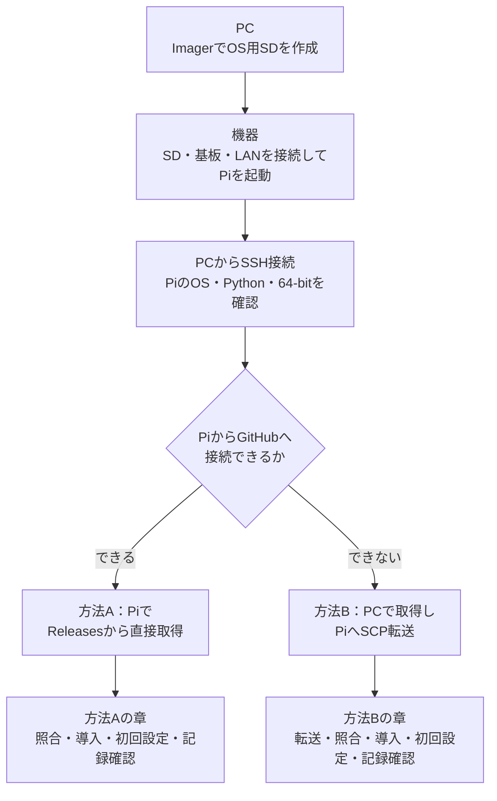
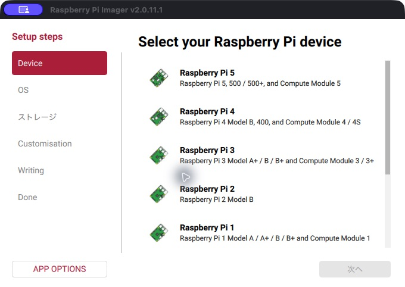
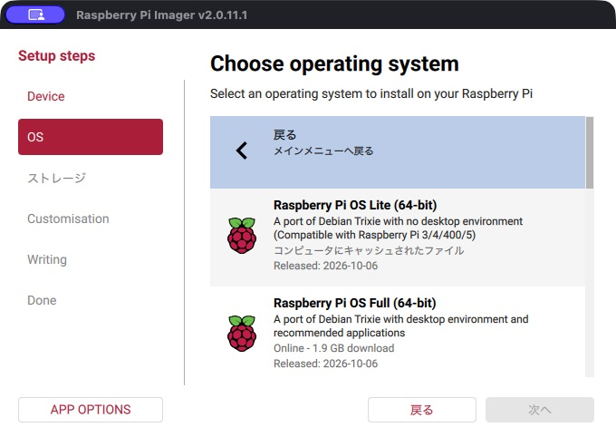
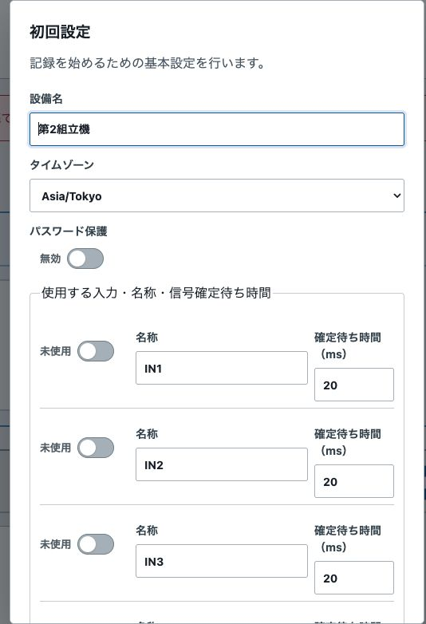
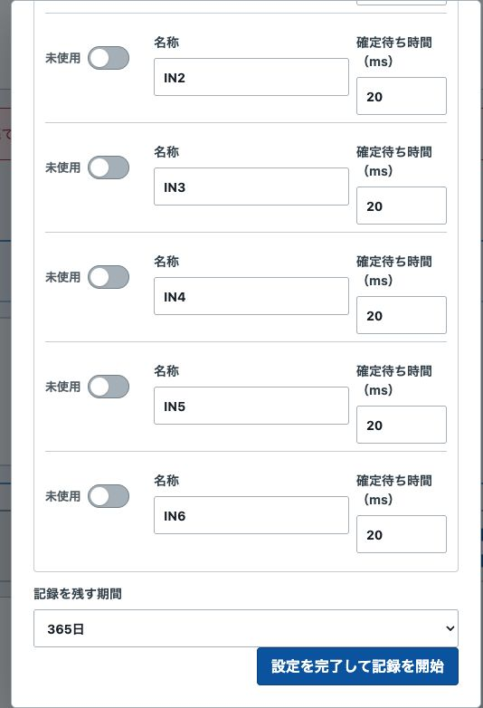

# インストール説明書

設備イベントロガー / 24V Event Logger　0.1.6向け　2026-10-11

製品の構成と使用条件は[概要説明書](概要説明書.md)を参照してください。ここでは**新品または消去してよいmicroSDカードを使用して、初めて導入する手順**を説明します。導入済みのPiを更新する際は、このSD作成手順を使用しないでください。

対応基板：らずぱい工房「[Raspberry Pi用　絶縁24VPNP入出力HAT基板](https://raspikoubou.theshop.jp/items/92486466)」

**適用範囲：** Windows PCまたはMacを使い、新規のRaspberry Pi 5に本ソフトを導入する場合を対象とします。プログラムの作成は不要ですが、LAN接続、ファイル操作、指定コマンドの実行が必要です。24V設備の配線は、設備とHATの電気仕様を把握した担当者が実施してください。

**作業方法：** 各工程では「操作する機器」と「正常に終了したことを示す結果」を確認します。エラーのまま次の操作へ進まないでください。SD消去・設定変更などの操作は既存データに影響するため、作業対象を確認して実施してください。

<br>

## 1. 導入前の確認

**導入工程と操作する機器**




概要説明書に記載された必要な物を揃えてください。SDに残したいデータがある場合は、作業を中断してバックアップを取ってください。**OSを書き込むと、SD内のOS・写真・設定・記録などはすべて消えます。** ファイルを一部コピーするだけではPi全体の復旧用バックアップにはなりません。

以下の設定情報を控えてください。パスワードは第三者が閲覧できる資料やGitHubに書き込まないでください。

| 情報 | 本書で使う例 |
|---|---|
| OS作成時のホスト名（Piのネットワーク上の名前） | `event-logger-setup` |
| Piにログインするユーザー名 | `logger` |
| Piのパスワード | 自分で設定したパスワード（初期パスワードなし） |
| 接続するWi-Fi名 | 自分のネットワークの名前。有線LANなら不要 |
| 導入後のPiのIPv4アドレス | 後の手順で控える |

### 導入工程と完了条件

| 工程 | 操作する機器 | 完了を確認する事項 |
|---|---|---|
| OS用SD作成（第2章） | PC | Imagerによる書き込みと検証が完了している |
| Pi起動と接続（第3・4章） | Pi・PC | SSHでログインでき、OS・Python・64-bitの条件が一致する |
| 方法A：Piで取得から導入完了まで（第6章） | Pi（SSH経由）・Webブラウザ | 照合・インストール・初回設定を終え、記録を確認できた |
| 方法B：PCで取得して転送し導入完了まで（第7章） | PC・Pi（SSH経由）・Webブラウザ | 転送・照合・インストール・初回設定を終え、記録を確認できた |

コマンド例のうち、ユーザー名とIPv4は自分の環境の値に置き換えてください。入力待ちを示す表示（例：`logger@event-logger-setup:~ $`）はコマンドの一部ではないため、コピーに含めないでください。

<br>

## 2. OS用SDの作成

**操作する場所：Windows PCまたはMac。Piの電源は切っておきます。**

画面の画像と操作を、実際に作業する順番にまとめています。Imagerのバージョン・OS・表示言語により画面が多少異なる場合があります。

1. [Raspberry Pi公式ソフトウェアページ](https://www.raspberrypi.com/software/)からPC用のRaspberry Pi Imagerをインストールして起動します。
2. microSDカードをPCのカードリーダーに挿入します。
3. **機種選択：** 「Device／機種」で**Raspberry Pi 5**を選び、「次へ」を押します。

   

4. **OS一覧：** 「OS」で一覧を下にスクロールし、「Raspberry Pi OS (other)」を開きます。最上段などに表示されるDesktop版は選ばないでください。

   

5. **OS確定：** **Raspberry Pi OS Lite (64-bit)**を選びます。説明に**Debian Trixie**と**no desktop environment**があることを確認してください。32-bit版や別のDebianバージョンは選ばないでください。

   

   **指定OSが見つからない場合：** [Raspberry Pi公式サイト](https://www.raspberrypi.com/software/)から最新版のImagerを入れ直し、OS一覧を再確認してください。<br>
   それでも表示されない場合は、[Raspberry Pi OS公式ダウンロードページ](https://www.raspberrypi.com/software/operating-systems/)を開き、「**Raspberry Pi OS (64-bit)**」の「**Raspberry Pi OS Lite**」を探します。「Debian version 13 (trixie)」「System 64-bit」「no desktop environment」を確認して「Download」でOSイメージをPCへ保存してください。<br>
   ImagerのOS選択画面で「Use custom／カスタムイメージを使用」を選び、保存したイメージファイルを指定します。続いて本章の手順6〜10に従い、SDの選択、ホスト名・ユーザー・SSHの設定、書き込みと検証を行ってください。**Legacy・32-bit・Desktop版を代用しないでください。**

6. **保存先：** 「Storage／保存先」でSDを選びます。容量と機器名を確認し、PCの内蔵ディスクが選択されていないことを確かめてください。
7. **カスタマイズ：** 次の項目を設定します。Imagerのバージョンや表示言語によって項目名が異なる場合があります。

   | 項目 | 設定内容 |
   |---|---|
   | Hostname／ホスト名 | `event-logger-setup` |
   | 地域・時刻 | 日本で使用する場合はJapan、Asia/Tokyo |
   | User／ユーザー | ユーザー名は`logger`、パスワードは自分で設定 |
   | Wi-Fi | 利用する場合、閲覧用PCと同じネットワークのSSIDとパスワード |
   | Remote Access／リモートアクセス | SSHを有効にし、上で決めたパスワードでログインする方式 |

8. **書き込み：** OS・SD・設定を確認して書き込みます。消去対象がSDであることを確認して承認してください。
9. **検証：** 書き込み後の検証を省略せず、「完了／Done」になるまで待ちます。
10. **Piへの挿入：** PCからSDを安全に取り外し、電源OFFのPiへ挿します。

**完了条件：** OSの書き込みと検証が正常に完了していること。この段階では、イベントロガー本体はまだインストールされていません。

掲載画像はmacOS版Raspberry Pi Imager 2.0.11.1の実画面です。画像は機種・OSの選択操作を示し、書き込みを実行した画像ではありません。Raspberry Pi Imager © Raspberry Pi Ltd。出所：[公式配布ページ](https://www.raspberrypi.com/software/)、[公式ソース・ライセンス](https://github.com/raspberrypi/rpi-imager)。

<br>

## 3. 基板・ネットワークの接続と起動

1. Pi・HAT・接続先の電源をOFFにした状態で、HATを正しい向きで取り付けます。
2. HATの商品説明と接続先設備の図面に従って、電源・入力信号を配線します。この説明書は、端子の定格や設備の配線図に代わるものではありません。
3. 確認用のOUT→IN配線は、設備への本配線とは別です。確認用配線を残したまま設備に接続しないでください。
4. 有線LANを使う場合はPiとルーター等をLANケーブルで接続します。PC・スマートフォンも同じLANに接続します。方法BでもPCからPiへSSH／SCP接続できるLAN内の経路が必要です。LAN内の接続と、Piからインターネットへの接続は別です。
5. 電源をONにし、初回起動とネットワーク接続を待ちます。

**起動確認：** SSHに接続できない場合は、Piの電源、LANケーブルまたはWi-Fiの設定、ルーターの接続端末一覧を先に確認します。原因を確認せずにOSを書き直さないでください。

<br>

## 4. SSH接続とOSの確認

SSHは、PCからPiに接続してコマンドを実行する方法です。ここではプログラムを作らず、指定のコマンドを一つずつ実行します。

SSH接続では、Piでコマンドを実行できることと、OSとPythonのバージョンが導入条件を満たしていることを確認します。接続後にPCのターミナルへ入力したコマンドは、Pi側で実行されます。

**Windows:** スタートメニューで「PowerShell」を検索して開きます。  
**Mac:** Spotlight検索（Command＋Space）で「ターミナル」を検索して開きます。

本書のユーザー名・ホスト名でSDを作った場合、次をコピーしてEnterを押します。

```sh
ssh logger@event-logger-setup.local
```

ユーザー名やホスト名を変更した場合は、`logger`と`event-logger-setup`をそれぞれ設定した値に置き換えてください。

- 初回の接続確認が出たら、これから接続するPiであることを確認して`yes`を入力しEnterを押します。
- `Password:`が出たら、**Imagerで決めたPiのパスワード**を入力します。PCのパスワードではありません。入力しても文字や●が表示されないのが正常です。
- 接続すると、行頭が例えば`logger@event-logger-setup:~ $`となります。**以後、`exit`を実行するまでコマンドはPi側で実行されます。** 入力待ちの表示をコピーしてコマンドに含めないでください。

**接続に成功した場合の表示例（Windows PowerShell）：**

```text
PS C:\Users\user> ssh logger@event-logger-setup.local
The authenticity of host 'event-logger-setup.local' can't be established.
Are you sure you want to continue connecting (yes/no/[fingerprint])? yes
logger@event-logger-setup.local's password:
logger@event-logger-setup:~ $ pwd
/home/logger
logger@event-logger-setup:~ $
```

`PS C:\Users\user>`は**PCの入力待ち表示**、`logger@event-logger-setup:~ $`は**Piの入力待ち表示**です。`pwd`は現在の作業フォルダーを確認するコマンドです。`/home/logger`が表示されれば、Piの`logger`ユーザーのホームフォルダーにいます。表示例の入力待ち部分はコピーしないでください。

### 接続できない場合

| 表示・状況 | 対処 |
|---|---|
| 名前が見つからない／Could not resolve hostname | ルーターの接続端末一覧でPiのIPv4を調べる。例えば`192.168.1.50`なら`ssh logger@192.168.1.50`。例の数値は実際のPiのIPv4へ置き換える |
| Connection refused／Timed out | Piの起動、電源、LAN接続、ImagerでSSHを有効にしたか確認する |
| Permission denied | ユーザー名とPiのパスワードを確認する |
| REMOTE HOST IDENTIFICATION HAS CHANGED | 同じアドレスの別機器へ接続していないか確認。警告を無効化して進めない |

Piへ接続できたら、次を一つずつ実行します。

```sh
cat /etc/os-release
```

`VERSION_ID="13"`かつTrixie（例：`VERSION_CODENAME=trixie`）であることを確認します。

```sh
python3 --version
```

`Python 3.13.x`であることを確認します。本ソフトは`pyproject.toml`でPython 3.13以上3.14未満を指定しており、インストーラーもPython 3.13以外では停止します。

```sh
uname -m
```

`aarch64`であることを確認します。32-bit OSでは、本ソフトに同梱されたARM64用SQLiteライブラリを使用できません。

### OS・Python・64-bitの確認結果が異なる場合

最初に、SSHで接続した**Pi**で次を一つずつ実行し、値を控えます。3つとも一致していればSDの再作成は不要です。

```sh
cat /etc/os-release
python3 --version
uname -m
```

**正常な表示例**（`cat /etc/os-release`は多数の行が出ます。ここでは必要な行だけを抜粋しています）：

```text
VERSION_ID="13"
VERSION_CODENAME=trixie
Python 3.13.5
aarch64
```

| 異なる結果 | 原因の確認と具体的な対処 |
|---|---|
| `VERSION_ID="12"`／`VERSION_CODENAME=bookworm`など | 初回導入用SDに別のOSが書き込まれています。**第2章の手順3〜10**をもう一度行い、Raspberry Pi OS Lite (64-bit)、Debian 13／Trixieを選んでSDを書き直してください。 |
| `VERSION_ID="13"`でも`VERSION_CODENAME`が`trixie`でない、または値が確認できない | `cat /etc/os-release`に表示された`PRETTY_NAME`も確認してください。別OSなら第2章の手順に従い**TrixieのLite 64-bitイメージを選び直して書き込み**ます。Imagerの一覧にないときは第2章の「指定OSが見つからない場合」の手順を使用してください。 |
| `Python 3.12.x`／`Python 3.14.x`など | 下記の「Pythonだけ異なる場合」に進みます。OS標準のPythonが3.13なら、OSを作り直す前に別のPythonが優先されていないか確認します。 |
| `armv7l`など、`aarch64`以外 | 32-bit OSの可能性があります。第2章の手順5で**(64-bit)**を選び、初回導入用SDを書き直してください。 |

**Pythonだけ異なる場合**

まず、どのPythonが呼び出されているかと、OS標準のPythonのバージョンを調べます。

```sh
command -v python3
/usr/bin/python3 --version
sudo python3 --version
echo "$VIRTUAL_ENV"
```

例えば次の結果なら、通常の`python3`が`/usr/local/bin`の別環境を指していますが、OS標準と管理者権限で実行されるPythonは3.13です。

```text
/usr/local/bin/python3
Python 3.13.5
Python 3.13.5

```

`echo "$VIRTUAL_ENV"`に`/home/logger/...`などが表示される場合は、仮想環境を使用している可能性があります。自分で有効化した仮想環境であれば`deactivate`を実行し、`python3 --version`を再確認してください。`/usr/local/bin/python3`などが優先される場合は、シェル起動設定やPATHの変更を管理者と確認します。**OS標準の`python3`やシンボリックリンクを上書きしないでください。**

OS標準の`/usr/bin/python3 --version`まで3.13以外の場合は、初回導入用SDなら第2章からTrixieのLite 64-bitを再書き込みします。**運用中のSDは書き直さず、データを保全して環境の復旧を行ってください。**

<br>

**注意：** SDの再書き込みにより既存データは消去されます。対象が**新品または消去してよいSD**であることを確認してください。OSを上書きアップグレードして版数だけ合わせる方法は案内していません。

<br>

```sh
hostname -I
```

表示された`192.168...`など、ピリオドで区切られた4組の数字からなるIPv4アドレスを控えます。このアドレスをブラウザでの接続に使用します。複数表示された場合は、PCと同じLANに接続しているIPv4を使用します。

**SSH接続を維持したまま第5章で方法を選択してください。** 方法AではそのままPiで作業し、方法Bでは第7章の転送手順で`exit`してPCへ戻ります。

### コマンドの実行場所を確認する

**コマンドを入力する場所は、画面の入力待ち表示で判別します。** 次はPCからPiへ接続し、PiからPCへ戻る例です。

```text
PS C:\Users\user> ssh logger@event-logger-setup.local
logger@event-logger-setup.local's password:
logger@event-logger-setup:~ $ python3 --version
Python 3.13.5
logger@event-logger-setup:~ $ exit
logout
Connection to event-logger-setup.local closed.
PS C:\Users\user>
```

- `PS C:\Users\user>`：**PCのPowerShell**。方法B（第7章）の`cd`や`scp`を実行します。Macでは表示が異なります。
- `logger@event-logger-setup:~ $`：**PiのSSH画面**。OSの確認、方法A（第6章）のダウンロードとインストール、方法B（第7章）の照合とインストールを実行します。
- `exit`：SSH接続を終了してPCの画面へ戻ります。**Piの電源は切れません。**

上の入力待ち表示と実行結果は説明用です。**入力するのは`ssh ...`、`python3 --version`、`exit`など、記号`>`または`$`の右側のコマンドだけです。**

<br>

## 5. 導入方法の選択

本ソフトの導入用ファイルは[GitHub Releases v0.1.6](https://github.com/raspikoubou/24v-event-logger-oss/releases/tag/v0.1.6)から取得します。必要なファイルは`event-logger-0.1.6.tar.zst`と`SHA256SUMS`の2点です。GitHubの「Source code（zip／tar.gz）」は導入用ファイルではありません。

| 接続環境 | 実施する手順 |
|---|---|
| **PiからGitHubへアクセスできる** | **第6章「方法A：Piで直接取得して導入」** |
| **PiからGitHubへアクセスできないが、PCからGitHubへアクセスでき、PCとPiがLAN接続できる** | **第7章「方法B：PCで取得してPiへ転送して導入」** |

**選択した方法の章だけを、冒頭から最後まで順番に実施してください。** どちらの章にも、ファイル取得・照合・インストール・初回設定・動作確認を含めています。**方法Aと方法Bの作業を交互に行う必要はありません。**

方法Bはファイルの取得経路を変える手段です。Pi側のAPT・Python依存ソフトの導入には、必要に応じてインターネット接続が必要です。

<br>

## 6. 方法A：Piで直接取得して導入

**対象：PiからGitHubへアクセスできる場合。** 第4章からSSH接続した**Pi側**の画面で作業します。PCへのダウンロードやSCP転送は不要です。**A-1からA-10までを順番に実施してください。**

### A-1. curlが使用できるか確認する

次のコマンドを実行します。

```sh
curl --version
```

**成功例：** 以下のように`curl`と`libcurl`のバージョン情報が表示されます。数値は例なので一致する必要はありません。

```text
curl 8.14.1 (aarch64-unknown-linux-gnu) libcurl/8.14.1
Release-Date: 2025-06-04
```

**失敗例：**

```text
-bash: curl: command not found
```

このエラーが出た場合のみ、Piで次を実行して`curl`をインストールし、`curl --version`をもう一度実行してください。

```sh
sudo apt update
sudo apt install curl
curl --version
```

インストール後も`curl`のバージョンが表示されなければ、第9章のトラブル対応を行ってください。

<br>

### A-2. 配布ファイル2点をPiへダウンロードする

次のコマンドを**上から1つずつ**実行します。`cd ~`はファイルを保存する場所をPiのホームフォルダーに切り替えます。

```sh
cd ~
curl --fail --location --show-error --retry 3 --output event-logger-0.1.6.tar.zst https://github.com/raspikoubou/24v-event-logger-oss/releases/download/v0.1.6/event-logger-0.1.6.tar.zst
```

```sh
curl --fail --location --show-error --retry 3 --output SHA256SUMS https://github.com/raspikoubou/24v-event-logger-oss/releases/download/v0.1.6/SHA256SUMS
```

**成功時の表示例：** ダウンロード状況が`100`で終了し、エラーを出さずにPiの入力待ち表示に戻ります。`curl`の表示形式は環境により変わるため、次のファイル確認も行います。

```text
  % Total    % Received % Xferd  Average Speed   Time    Time     Time  Current
                                 Dload  Upload   Total   Spent    Left  Speed
100 3872k  100 3872k    0     0  1500k      0  0:00:02  0:00:02 --:--:-- 1500k
logger@event-logger-setup:~ $
```

※上記の進捗・速度・所要時間は表示例です。`SHA256SUMS`は93バイト程度の小さなファイルなので、進捗が瞬時に終わる場合があります。

<br>

### A-3. 保存されたファイルを確認する

```sh
ls -lh event-logger-0.1.6.tar.zst SHA256SUMS
```

**成功例：** 2ファイルとも表示されます。サイズは配布中の0.1.6 Assetsに合わせた例です（日時は環境により異なります）。

```text
-rw-r--r-- 1 logger logger 3.8M Oct 12 10:00 event-logger-0.1.6.tar.zst
-rw-r--r-- 1 logger logger   93 Oct 12 10:00 SHA256SUMS
```

**失敗例と対処：**

| 表示例 | 確認すること・対処 |
|---|---|
| `curl: (22) The requested URL returned error: 404` | Releaseタグ・ファイル名に誤りがないか確認し、上のURLをコピーし直します。 |
| `curl: (22) The requested URL returned error: 403` | GitHubへのアクセス制限・認証状態を確認します。PCから取得できる場合は方法Bへ切り替えます。 |
| `curl: (6) Could not resolve host: github.com` | PiのDNS・ネットワーク設定を確認します。PiからGitHubへ接続できなければ方法Bへ切り替えます。 |
| `curl: (7) Failed to connect`、`curl: (28) Operation timed out` | Piのネットワーク、プロキシ、ファイアウォールを確認します。PCから取得できる場合は方法Bへ切り替えます。 |
| `ls: cannot access 'SHA256SUMS': No such file or directory` | `SHA256SUMS`が保存されていません。2番目の`curl`コマンドを再実行します。 |
| `ls: cannot access 'event-logger-0.1.6.tar.zst': No such file or directory` | アーカイブが保存されていません。1番目の`curl`コマンドを再実行します。 |

**完了条件：** ダウンロードコマンドがエラーなく終了し、上の2ファイルが存在すること。ファイルの同一性はA-4のSHA-256照合で確認します。**SSHを切断せず、A-4へ進んでください。**

<br>

### A-4. 配布ファイルの照合

```sh
cd ~
sha256sum -c SHA256SUMS
```

`event-logger-0.1.6.tar.zst: OK`と出れば成功です。`FAILED`やエラーが表示された場合は、作業を中断して2ファイルを同じ配布元からダウンロードし直してください。

この照合は、配布ファイルの破損や取り違えを検出するために行います。失敗した場合は、展開・インストールを実行しないでください。

### A-5. 展開と導入に必要なソフトを用意する

```sh
sudo apt update
sudo apt install python3-venv zstd
```

パスワードはPiのものです。確認が出たら内容を読み、続ける場合は`Y`とEnterを押します。エラーが出た場合は次へ進まないでください。

**導入時のネットワーク：** この手順の`apt`とインストーラーの`pip install`は、必要な依存ソフトがPiにない場合、インターネットへの接続が必要です。取得に失敗する場合は、Piを一時的にインターネットへ接続してコマンドを再実行してください。接続できない場合は、必要なパッケージとwheelを別途用意するオフライン導入手順が必要です（本書の対象外）。

### A-6. 配布ファイルを展開する

```sh
mkdir event-logger-0.1.6
tar --zstd -xf event-logger-0.1.6.tar.zst -C event-logger-0.1.6
```

展開が正常に終わると、通常はエラーが表示されずにコマンドの入力待ちに戻ります。`File exists`が表示された場合は以前の作業で作成したフォルダーが残っている可能性があります。内容を確認せずに削除・上書きしないでください。

### A-7. インストーラーを実行する

```sh
sudo bash event-logger-0.1.6/packaging/install.sh
```

初回は必要なソフトウェアを取得するため時間がかかります。完了するまで電源を切らないでください。`インストール完了: http://.../`が表示され、エラーなく命令待ちに戻ったことを確認してください。

```sh
systemctl is-active event-loggerd event-logger-web event-logger-update
```

3行とも`active`なら起動しています。`active`以外が表示された場合は、第9章のトラブル対応でサービス状態を確認してください。

上から順に、入力記録・Web画面・更新処理の各サービスの状態が表示されます。`inactive`や`failed`が含まれる場合は正常完了ではありません。3件が`active`でも、設備の信号変化が正常に記録されるかは本章のA-10で確認する必要があります。

```sh
hostname -I
```

PiのIPv4をもう一度控えます。製品の導入でホスト名は`event-logger-XXXX`へ変わるため、以後はIPv4で接続すると確実です。ルーターの設定によってIPv4も後日変わる場合があります。

### A-8. Web更新の配布元を設定する

初回導入の既定設定では、Web画面の更新先が未設定です。PiへSSH接続したまま、次を実行します。この操作は更新先を登録するもので、ソフトウェア更新を開始しません。

```sh
sudo nano /etc/event-logger/event-logger.env
```

ファイル内の次のコメント行を探します。

```text
# EVENT_LOGGER_UPDATE_REPOSITORY=owner/repository
```

その行を次の内容に置き換えてください。先頭の`#`も取り除き、他の行は変更しないでください。

```text
EVENT_LOGGER_UPDATE_REPOSITORY=raspikoubou/24v-event-logger-oss
```

Control＋O、Enterで保存し、Control＋Xで終了します。続いてWeb画面のサービスを再起動します。

`nano`は設定ファイルを文字で編集する画面です。変更対象は指定された1行だけです。先頭の`#`が残っていると設定が有効にならないため、削除して保存してください。他の設定行は変更しないでください。

```sh
sudo systemctl restart event-logger-web
systemctl is-active event-logger-web
```

`active`を確認します。ブラウザを再読み込みし、診断の「更新を確認」で配布元を確認できます。現在のバージョンが最新の場合は、更新を適用する必要はありません。更新先を変更しても、記録処理は再起動されません。**Piがインターネットへ接続できない場合、GitHub Releasesを使うWeb更新確認・更新適用は利用できません。**

<br>

### A-9. 初回設定

PCまたはスマートフォンのブラウザの**アドレス欄**に`http://PiのIPv4/`を入力します。検索欄ではありません。例えばPiが`192.168.1.50`なら`http://192.168.1.50/`です。端末をPiと同じLANに接続してください。



*0.1.6のデモ環境で撮影。設備名・数値は表示例です。*

| 項目 | 設定内容 |
|---|---|
| 設備名 | 自分が識別できる名前。例「第1組立機」 |
| タイムゾーン | 日本なら`Asia/Tokyo` |
| パスワード保護 | 任意。有効にする場合はブラウザ閲覧用の共有パスワードを決める。PiのSSHパスワードとは別 |
| 使用する入力 | 配線したINだけ「使用中」にする |
| 名称 | 信号の意味。例「運転信号」「完了信号」 |
| 確定待ち時間（ms） | 初期値20ms。安定した状態がこの時間続いた後に記録する。20msは0.02秒。短い信号を記録する場合は設備の仕様に合わせる |
| 記録を残す期間 | 必要な期間を選ぶ。初期値は365日 |

初回設定画面の**内側を下にスクロール**すると、残りの入力項目と完了ボタンが表示されます。



配線と設定を確認して「**設定を完了して記録を開始**」を押します。このボタンを押すと記録が始まります。画面右上が「記録中」になったことを確認してください。

<br>

### A-10. 導入後の動作確認

1. 「診断」を開き、App versionが`0.1.6`、設定反映が「一致」、ストレージ状態が正常であることを確認します。
2. NTP同期状態とシステム時刻を確認します。NTPが未同期の場合は、記録された時刻が正確だと判断せず、ネットワークと時刻設定を確認してください。
3. 接続した信号を、設備の担当者が安全にON/OFFします。「ログ」で、該当する入力のON/OFF変化が記録されていることを確認します。
4. ダッシュボードが空なら、[取扱説明書 第5章](取扱説明書.md#5-表示項目の追加編集配置)へ進みます。ダッシュボードに表示項目がなくても、入力信号の記録は継続します。

控えておく情報：PiのIPv4、導入後のホスト名、OSログイン名、導入したバージョン、設備名。パスワードは安全な別の場所で管理します。

#### A-10-1. 導入完了の判定

| 確認項目 | 完了条件 |
|---|---|
| Web画面 | PC・スマートフォンからPiのIPv4で開ける |
| 設定・記録 | 診断で設定反映「一致」、記録状態「記録中」を確認できる |
| 設備の入力信号 | 安全にON/OFFした信号の変化が、該当INのログへ表示される |

この3項目をすべて満たした時点で、基本的な記録機能の導入が完了したと判断できます。ダッシュボードの表示項目は記録機能と独立して設定するため、表示項目がない場合でも、使用中の入力は記録されます。未確認の項目を残したまま通常運用へ移らないでください。

<br>


<br>

## 7. 方法B：PCで取得してPiへ転送して導入

**対象：PiからGitHubへアクセスできず、PCからGitHubへアクセスできる場合。** 第4章のSSH接続を確認済みであることが前提です。**B-1からB-10までを順番に実施してください。PiからGitHubへの直接ダウンロードは行いません。**

### B-1. PCで配布ファイルを取得する

**操作する場所：Windows PCまたはMacのWebブラウザ。**

[GitHub Releasesの0.1.6](https://github.com/raspikoubou/24v-event-logger-oss/releases/tag/v0.1.6)を開き、「Assets」から`event-logger-0.1.6.tar.zst`と`SHA256SUMS`をダウンロードします。PCがGitHubへ接続できる必要があります。

ブラウザが`SHA256SUMS.txt`などに名前を変えた場合は、ファイル名を`SHA256SUMS`へ戻してください。Windowsで拡張子が見えない場合は、エクスプローラーの表示設定で「ファイル名拡張子」を表示します。

PCの「ダウンロード／Downloads」フォルダーに2ファイルを置きます。保存先が異なる場合は2ファイルをこのフォルダーへ移してください。

**完了条件：** PCのDownloadsフォルダーに2ファイルが揃っていること。どちらかがない場合は取得し直してください。次にB-2でPiへ転送します。

<br>

### B-2. PCからPiへ配布ファイルを転送する

**操作する場所：PCのPowerShellまたはターミナル。** 第4章でPiへSSH接続したままなら、Pi上で次を実行してPC側へ戻ります。

```sh
exit
```

Windowsの場合：

```powershell
cd "$HOME\Downloads"
```

Macの場合：

```sh
cd ~/Downloads
```

次の転送コマンドでは、`192.168.1.50`を第4章で控えたPiのIPv4に置き換えてください。ユーザー名を変更した場合は`logger`も設定した値に置き換えてください。

```sh
scp event-logger-0.1.6.tar.zst SHA256SUMS logger@192.168.1.50:~/
```

Piのパスワードを入力し、2ファイルとも転送が完了するまで待ちます。`No such file`が表示された場合は、ファイル名と保存場所を確認してください。転送に失敗したまま進まないでください。

#### 転送コマンドの意味と確認結果

`scp`はPCからPiへファイルをコピーするコマンドです。PCのダウンロードフォルダーにある2ファイルを、Piのホームディレクトリ（行末の`:~/`）へ送ります。書き換えるのはユーザー名とPiのIPv4だけです。`:~/`はそのままにします。

**完了条件：** 転送がエラーなく終了し、PCの入力待ち表示に戻ること。B-3でPiへ再接続した後、B-4でSHA-256照合を行います。

<br>

### B-3. PiにSSHで再接続する

**操作する場所：PCのPowerShellまたはターミナル。** B-2の`scp`を実行したPCの画面で、Piへ再接続します。`192.168.1.50`は第4章で控えたPiのIPv4に、`logger`は必要に応じて自分のユーザー名に置き換えてください。

```sh
ssh logger@192.168.1.50
```

**成功時：** Piのパスワード入力後に`logger@event-logger-setup:~ $`などのPi側の入力待ち表示へ変わります。失敗した場合は第4章の「接続できない場合」を確認し、接続できるまで次に進まないでください。**以後、B-4～B-8はPi側で実行します。**

<br>

### B-4. 配布ファイルの照合

```sh
cd ~
sha256sum -c SHA256SUMS
```

`event-logger-0.1.6.tar.zst: OK`と出れば成功です。`FAILED`やエラーが表示された場合は、作業を中断して2ファイルを同じ配布元からダウンロードし直してください。

この照合は、配布ファイルの破損や取り違えを検出するために行います。失敗した場合は、展開・インストールを実行しないでください。

### B-5. 展開と導入に必要なソフトを用意する

```sh
sudo apt update
sudo apt install python3-venv zstd
```

パスワードはPiのものです。確認が出たら内容を読み、続ける場合は`Y`とEnterを押します。エラーが出た場合は次へ進まないでください。

**導入時のネットワーク：** この手順の`apt`とインストーラーの`pip install`は、必要な依存ソフトがPiにない場合、インターネットへの接続が必要です。PCで配布ファイルを取得・転送しただけでは依存ソフトは揃いません。取得に失敗する場合は、Piを一時的にインターネットへ接続してコマンドを再実行してください。接続できない場合は、必要なパッケージとwheelを別途用意するオフライン導入手順が必要です（本書の対象外）。

### B-6. 配布ファイルを展開する

```sh
mkdir event-logger-0.1.6
tar --zstd -xf event-logger-0.1.6.tar.zst -C event-logger-0.1.6
```

展開が正常に終わると、通常はエラーが表示されずにコマンドの入力待ちに戻ります。`File exists`が表示された場合は以前の作業で作成したフォルダーが残っている可能性があります。内容を確認せずに削除・上書きしないでください。

### B-7. インストーラーを実行する

```sh
sudo bash event-logger-0.1.6/packaging/install.sh
```

初回は必要なソフトウェアを取得するため時間がかかります。完了するまで電源を切らないでください。`インストール完了: http://.../`が表示され、エラーなく命令待ちに戻ったことを確認してください。

```sh
systemctl is-active event-loggerd event-logger-web event-logger-update
```

3行とも`active`なら起動しています。`active`以外が表示された場合は、第9章のトラブル対応でサービス状態を確認してください。

上から順に、入力記録・Web画面・更新処理の各サービスの状態が表示されます。`inactive`や`failed`が含まれる場合は正常完了ではありません。3件が`active`でも、設備の信号変化が正常に記録されるかは本章のB-10で確認する必要があります。

```sh
hostname -I
```

PiのIPv4をもう一度控えます。製品の導入でホスト名は`event-logger-XXXX`へ変わるため、以後はIPv4で接続すると確実です。ルーターの設定によってIPv4も後日変わる場合があります。

### B-8. Web更新の配布元を設定する

初回導入の既定設定では、Web画面の更新先が未設定です。PiへSSH接続したまま、次を実行します。この操作は更新先を登録するもので、ソフトウェア更新を開始しません。

```sh
sudo nano /etc/event-logger/event-logger.env
```

ファイル内の次のコメント行を探します。

```text
# EVENT_LOGGER_UPDATE_REPOSITORY=owner/repository
```

その行を次の内容に置き換えてください。先頭の`#`も取り除き、他の行は変更しないでください。

```text
EVENT_LOGGER_UPDATE_REPOSITORY=raspikoubou/24v-event-logger-oss
```

Control＋O、Enterで保存し、Control＋Xで終了します。続いてWeb画面のサービスを再起動します。

`nano`は設定ファイルを文字で編集する画面です。変更対象は指定された1行だけです。先頭の`#`が残っていると設定が有効にならないため、削除して保存してください。他の設定行は変更しないでください。

```sh
sudo systemctl restart event-logger-web
systemctl is-active event-logger-web
```

`active`を確認します。ブラウザを再読み込みし、診断の「更新を確認」で配布元を確認できます。現在のバージョンが最新の場合は、更新を適用する必要はありません。更新先を変更しても、記録処理は再起動されません。**Piがインターネットへ接続できない場合、GitHub Releasesを使うWeb更新確認・更新適用は利用できません。**

<br>

### B-9. 初回設定

PCまたはスマートフォンのブラウザの**アドレス欄**に`http://PiのIPv4/`を入力します。検索欄ではありません。例えばPiが`192.168.1.50`なら`http://192.168.1.50/`です。端末をPiと同じLANに接続してください。


*0.1.6のデモ環境で撮影。設備名・数値は表示例です。*

| 項目 | 設定内容 |
|---|---|
| 設備名 | 自分が識別できる名前。例「第1組立機」 |
| タイムゾーン | 日本なら`Asia/Tokyo` |
| パスワード保護 | 任意。有効にする場合はブラウザ閲覧用の共有パスワードを決める。PiのSSHパスワードとは別 |
| 使用する入力 | 配線したINだけ「使用中」にする |
| 名称 | 信号の意味。例「運転信号」「完了信号」 |
| 確定待ち時間（ms） | 初期値20ms。安定した状態がこの時間続いた後に記録する。20msは0.02秒。短い信号を記録する場合は設備の仕様に合わせる |
| 記録を残す期間 | 必要な期間を選ぶ。初期値は365日 |

初回設定画面の**内側を下にスクロール**すると、残りの入力項目と完了ボタンが表示されます。


配線と設定を確認して「**設定を完了して記録を開始**」を押します。このボタンを押すと記録が始まります。画面右上が「記録中」になったことを確認してください。

<br>

### B-10. 導入後の動作確認

1. 「診断」を開き、App versionが`0.1.6`、設定反映が「一致」、ストレージ状態が正常であることを確認します。
2. NTP同期状態とシステム時刻を確認します。NTPが未同期の場合は、記録された時刻が正確だと判断せず、ネットワークと時刻設定を確認してください。
3. 接続した信号を、設備の担当者が安全にON/OFFします。「ログ」で、該当する入力のON/OFF変化が記録されていることを確認します。
4. ダッシュボードが空なら、[取扱説明書 第5章](取扱説明書.md#5-表示項目の追加編集配置)へ進みます。ダッシュボードに表示項目がなくても、入力信号の記録は継続します。

控えておく情報：PiのIPv4、導入後のホスト名、OSログイン名、導入したバージョン、設備名。パスワードは安全な別の場所で管理します。

#### B-10-1. 導入完了の判定

| 確認項目 | 完了条件 |
|---|---|
| Web画面 | PC・スマートフォンからPiのIPv4で開ける |
| 設定・記録 | 診断で設定反映「一致」、記録状態「記録中」を確認できる |
| 設備の入力信号 | 安全にON/OFFした信号の変化が、該当INのログへ表示される |

この3項目をすべて満たした時点で、基本的な記録機能の導入が完了したと判断できます。ダッシュボードの表示項目は記録機能と独立して設定するため、表示項目がない場合でも、使用中の入力は記録されます。未確認の項目を残したまま通常運用へ移らないでください。

<br>


<br>

## 8. 電源停止・再起動

記録停止ボタンはPiの電源OFF操作ではありません。

1. ブラウザの「診断」で「記録を停止して出力テストへ」を押し、確認画面の「記録を停止」で確定して停止状態を確認します。
2. PCから、控えたユーザー名とIPv4でSSH接続します。
3. 再起動する場合はPiで次を実行します。

```sh
sudo reboot
```

電源を切る場合は、代わりに次を実行します。

```sh
sudo shutdown -h now
```

SSHが切断されます。切断直後に電源を抜かず、**Pi 5本体の電源ボタン横のランプが、動作中の緑から赤へ変わり、待機状態になったこと**を確認してから電源を切ります。起動直後や故障時も赤が点く場合があるので、「シャットダウン命令を実行した後に変わった」ことを確認してください。HAT側のランプとは別です。ランプが見えない場合や停止したか判断できない場合は、電源を抜かず、設置担当者に確認してください。[Pi 5のランプの公式説明](https://www.raspberrypi.com/documentation/computers/configuration.html#raspberry-pi-5-and-500-leds)。

明示的に停止した記録は再起動後も停止しています。使用を再開するときは、ブラウザの「診断」で「記録を再開」を押します。

<br>

## 9. 導入時のトラブル対応

| 状況 | 確認すること |
|---|---|
| インストーラーが失敗する | エラー内容を控え、Debian 13／Trixie・Python 3.13・ARM64・Raspberry Pi 5の使用、APT／pipの依存ソフト取得可否、空き容量を確認 |
| 方法Aの取得で`404`／`403`が出る | 第6章A-2のReleaseタグ・URL・ファイル名を確認する。403の場合はアクセス制限を確認し、PCから取得できれば第7章の方法Bを最初から実施する |
| PiからGitHubへ接続できない | PCがGitHubへ接続できるなら第7章の方法Bを利用。ただしPi側の依存ソフト取得が必要になる場合がある |
| 画面が開かない | Piの電源・LAN、現在のIPv4、アドレス欄の`http://`、PCと同じLANかを確認 |
| 画面は開くが記録されない | 右上の状態、入力の「使用中」、診断の設定反映と入力状態を確認 |

Piの状態を見る命令：

```sh
systemctl status event-loggerd event-logger-web --no-pager
```

最近のエラーを見る命令：

```sh
sudo journalctl -u event-loggerd -u event-logger-web -n 50 --no-pager
```

表示内容は診断用です。データベースの削除やOSの再作成は、記録と設定を失うため、復旧手順として使用しないでください。問い合わせ・不具合報告にはエラー文とバージョン番号を記載し、Wi-Fiやログインのパスワードは含めないでください。


### エラーの切り分け順序

1. **SSHでPiに接続できない：** Piの電源、LAN接続、IPv4、ImagerのSSH設定を確認します。
2. **Piには接続できるがWeb画面が開かない：** 第6章A-7または第7章B-7のサービス状態と第9章の診断コマンドを確認します。
3. **Web画面は開くが記録が増えない：** 記録状態、使用中のIN、設定反映、実際の信号変化を確認します。

問題が生じた操作、エラー全文、直前の変更を控えます。記録を共有する場合は、パスワードと設備の機密情報を取り除いてください。

<br>

## 10. アンインストール

ソフトウェアを使用しなくなる場合の操作です。記録を停止し、必要なCSVを保存してから、PiへSSH接続して次を実行します。

```sh
sudo bash /opt/event-logger/current/packaging/uninstall.sh
```

`アンインストール完了 (DB/設定は保持)。`を確認します。ソフトウェアと自動起動を削除し、DB・設定・バックアップはPiに残します。OSは削除しません。再導入する場合は、接続環境に合わせて第6章の方法A、または第7章の方法Bを選び、選択した章の取得・照合・インストール手順を実施します。既存DB・設定を再利用する場合は、SDを作り直しません。

`--purge`を付けると、ソフトウェアに加えてDB・設定・バックアップを削除する処理が行われます。通常のアンインストールでは指定しないでください。CSVだけではDBを復元できません。
