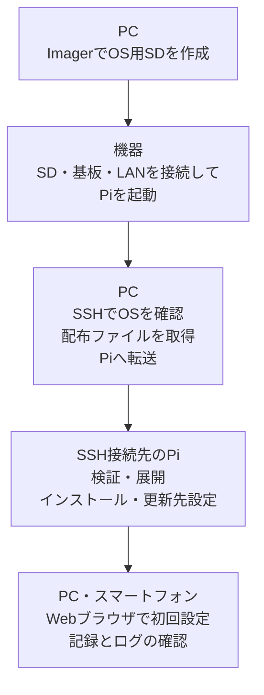
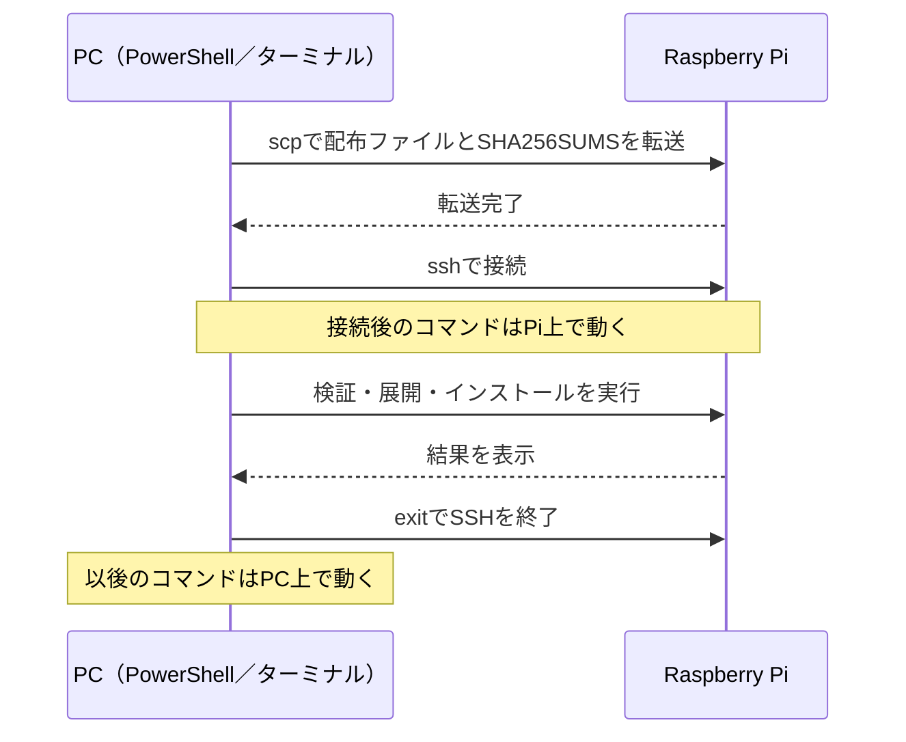

# インストール説明書

設備イベントロガー / 24V Event Logger　0.1.6向け　2026-10-09

製品の構成と使用条件は[概要説明書](概要説明書.md)を参照してください。ここでは**新品または消去してよいmicroSDカードを使用して、初めて導入する手順**を説明します。導入済みのPiを更新する際は、このSD作成手順を使用しないでください。

対応基板：らずぱい工房「[Raspberry Pi用　絶縁24VPNP入出力HAT基板](https://raspikoubou.theshop.jp/items/92486466)」

**適用範囲：** Windows PCまたはMacを使い、新規のRaspberry Pi 5に本ソフトを導入する場合を対象とします。プログラムの作成は不要ですが、LAN接続、ファイル操作、指定コマンドの実行が必要です。24V設備の配線は、設備とHATの電気仕様を把握した担当者が実施してください。

**作業方法：** 各工程では「操作する機器」と「正常に終了したことを示す結果」を確認します。エラーのまま次の操作へ進まないでください。SD消去・設定変更などの操作は既存データに影響するため、作業対象を確認して実施してください。

## 1. 導入前の確認

**導入工程と操作する機器**




概要説明書に記載された必要な物を揃えてください。SDに残したいデータがある場合は、作業を中断してバックアップを取ってください。**OSを書き込むと、SD内のOS・写真・設定・記録などはすべて消えます。** ファイルを一部コピーするだけではPi全体の復旧用バックアップにはなりません。

以下の設定情報を控えてください。パスワードは第三者が閲覧できる資料やGitHubに書き込まないでください。

| 情報 | 本書で使う例 |
|---|---|
| OS作成時のホスト名（Piのネットワーク上の名前） | `event-logger-setup` |
| Piにログインするユーザー名 | `logger` |
| Piのパスワード | 自分で設定したパスワード（初期パスワードなし） |
| 接続するWi-Fi名 | 自分のネットワークの名前。有線LANなら不要 |
| 導入後のPiのIPv4アドレス | 後の手順で控える |

### 導入工程と完了条件

| 工程 | 操作する機器 | 完了を確認する事項 |
|---|---|---|
| OS用SD作成（第2章） | PC | Imagerによる書き込みと検証が完了している |
| Pi起動と接続（第3・4章） | Pi・PC | SSHでログインでき、OSとPythonのバージョンが指定条件に一致する |
| ファイル取得・転送（第5・6章） | PC | 対象の配布ファイル2点をPiへ転送できた |
| インストール（第7章） | SSH接続したPi | SHA-256照合の結果がOKで、3つの対象サービスが`active` |
| 初回設定（第8・9章） | Webブラウザ | 記録中であること、設定の一致、入力変化がログに記録されたことを確認できた |

コマンド例のうち、ユーザー名とIPv4は自分の環境の値に置き換えてください。入力待ちを示す表示（例：`logger@event-logger-setup:~$`）はコマンドの一部ではないため、コピーに含めないでください。

## 2. OS用SDの作成

**操作する場所：Windows PCまたはMac。Piの電源は切っておきます。**

1. [Raspberry Pi公式ソフトウェアページ](https://www.raspberrypi.com/software/)を開き、使用するPCに対応したRaspberry Pi Imagerをインストールして起動します。
2. SDカードをPCのカードリーダーに挿入します。
3. 「Device／機種」で **Raspberry Pi 5** を選びます。
4. 「OS」で一覧を下にスクロールし、「Raspberry Pi OS (other)」を開いて **Raspberry Pi OS Lite（64-bit）、Debian 13／Trixie** を選びます。Desktop版や32-bit版は選ばないでください。該当するOSが表示されない場合は、別のOSで代用せず、作業を中断してください。
5. 「Storage／保存先」でSDを選びます。容量と機器名を確認し、PCの内蔵ディスクが選択されていないことを確かめてください。
6. 次のカスタマイズ項目を設定します。Imagerのバージョンや表示言語によって項目名が多少異なります。

| 項目 | 設定内容 |
|---|---|
| Hostname／ホスト名 | `event-logger-setup` |
| 地域・時刻 | 日本で使用する場合はJapan、Asia/Tokyo |
| User／ユーザー | ユーザー名は`logger`、パスワードは自分で設定 |
| Wi-Fi | 利用する場合、閲覧用PCと同じネットワークのSSIDとパスワード |
| Remote Access／リモートアクセス | SSHを有効。上で決めたパスワードでログインする方式 |

7. 最後にOS・SD・設定を確認して書き込みます。消去対象がSDであることを確認して承認してください。
8. 書き込み後の検証は省略しないでください。「完了／Done」になるまで待ちます。
9. PCからSDを安全に取り外し、電源OFFのPiへ挿します。

**完了条件：** OSの書き込みと検証が正常に完了していること。この段階では、まだイベントロガー本体はインストールされていません。

### 2-1. 機種選択画面


「Raspberry Pi 5」を選択して「次へ」を押します。

### 2-2. OS選択画面


この一覧の最上段はデスクトップ版です。一覧を下にスクロールし、「Raspberry Pi OS (other)」を開きます。


「Raspberry Pi OS Lite (64-bit)」を選択します。説明に「Debian Trixie」「no desktop environment」があることを確認します。

掲載画像はmacOS版Raspberry Pi Imager 2.0.11.1の実画面です。バージョン・OS・表示言語によって画面が異なります。画像は機種・OSの選択操作を示し、書き込みを実行した画像ではありません。Raspberry Pi Imager © Raspberry Pi Ltd。出所：[公式配布ページ](https://www.raspberrypi.com/software/)、[公式ソース・ライセンス](https://github.com/raspberrypi/rpi-imager)。

## 3. 基板・ネットワークの接続と起動

1. Pi・HAT・接続先の電源をOFFにした状態で、HATを正しい向きで取り付けます。
2. HATの商品説明と接続先設備の図面に従って、電源・入力信号を配線します。この説明書は、端子の定格や設備の配線図に代わるものではありません。
3. 確認用のOUT→IN配線は、設備への本配線とは別です。確認用配線を残したまま設備に接続しないでください。
4. 有線LANを使う場合はPiとルーター等をLANケーブルで接続します。PC・スマートフォンも同じLANに接続します。
5. 電源をONにし、初回起動とネットワーク接続を待ちます。

**起動確認：** SSHに接続できない場合は、Piの電源、LANケーブルまたはWi-Fiの設定、ルーターの接続端末一覧を先に確認します。原因を確認せずにOSを書き直さないでください。

## 4. SSH接続とOSの確認

SSHは、PCからPiに接続してコマンドを実行する方法です。ここではプログラムを作らず、指定のコマンドを一つずつ実行します。

SSH接続では、Piでコマンドを実行できることと、OSとPythonのバージョンが導入条件を満たしていることを確認します。接続後にPCのターミナルへ入力したコマンドは、Pi側で実行されます。

**Windows:** スタートメニューで「PowerShell」を検索して開きます。  
**Mac:** Spotlight検索（Command＋Space）で「ターミナル」を検索して開きます。

本書のユーザー名・ホスト名でSDを作った場合、次をコピーしてEnterを押します。

```sh
ssh logger@event-logger-setup.local
```

ユーザー名やホスト名を変更した場合は、`logger`と`event-logger-setup`をそれぞれ設定した値に置き換えてください。

- 初回の接続確認が出たら、これから接続するPiであることを確認して`yes`を入力しEnterを押します。
- `Password:`が出たら、**Imagerで決めたPiのパスワード**を入力します。PCのパスワードではありません。入力しても文字や●が表示されないのが正常です。
- 接続すると、行頭が例えば`logger@event-logger-setup:~$`となります。**以後、`exit`を実行するまでコマンドはPi側で実行されます。** 入力待ちの表示をコピーしてコマンドに含めないでください。

### 接続できない場合

| 表示・状況 | 対処 |
|---|---|
| 名前が見つからない／Could not resolve hostname | ルーターの接続端末一覧でPiのIPv4を調べる。例えば`192.168.1.50`なら`ssh logger@192.168.1.50`。例の数値は実際のPiのIPv4へ置き換える |
| Connection refused／Timed out | Piの起動、電源、LAN接続、ImagerでSSHを有効にしたか確認する |
| Permission denied | ユーザー名とPiのパスワードを確認する |
| REMOTE HOST IDENTIFICATION HAS CHANGED | 同じアドレスの別機器へ接続していないか確認。警告を無効化して進めない |

Piへ接続できたら、次を一つずつ実行します。

```sh
cat /etc/os-release
```

`VERSION_ID="13"`、Trixieであることを確認します。

```sh
python3 --version
```

`Python 3.13.x`であることを確認します。異なる場合は、ここで作業を中断してください。

```sh
hostname -I
```

表示された`192.168...`など、ピリオドで区切られた4組の数字からなるIPv4アドレスを控えます。このアドレスをブラウザでの接続に使用します。複数表示された場合は、PCと同じLANに接続しているIPv4を使用します。

```sh
exit
```

これでPCへ戻ります。以後のファイル転送はPC側で行います。

### 4-1. コマンドの実行場所を確認する

| 操作・表示 | コマンドの実行先 | 用途 |
|---|---|---|
| PCで開いたPowerShell／ターミナル | PC | ダウンロード先への移動、ファイル転送 |
| `logger@event-logger-setup:~$`のような入力待ち表示 | Pi | OS確認、照合、インストール |
| Piで`exit`を実行した後 | PC | 転送コマンドなどを再び実行できる |

`exit`はSSH接続を終了する操作です。Piの電源を切る操作ではありません。実行先を判別できない場合は、入力待ち表示を確認してから続行してください。

## 5. 配布ファイルの取得

[GitHub Releasesの0.1.6](https://github.com/raspikoubou/24v-event-logger-oss/releases/tag/v0.1.6)を開き、「Assets」から次の2ファイルをダウンロードします。

- `event-logger-0.1.6.tar.zst`
- `SHA256SUMS`

「Source code（zip／tar.gz）」は、この導入手順のファイルではありません。ブラウザが`SHA256SUMS.txt`等へ名前を変えた場合は、ファイル名を`SHA256SUMS`へ戻してください。Windowsで拡張子が見えない場合は、エクスプローラーの表示設定で「ファイル名拡張子」を表示します。

PCの「ダウンロード／Downloads」フォルダーに2ファイルを置きます。フォルダーが別の場所の場合は、2ファイルをこのフォルダーへ移してから進めます。

**配布ファイルを取得できない場合：** Releasesページに対象バージョンまたは「Assets」が表示されなければ、配布がまだ公開されていない可能性があります。別のバージョンや「Source code」で代用せず、対象バージョンの配布を確認するまで作業を中断してください。

`event-logger-0.1.6.tar.zst`はインストール用ファイル、`SHA256SUMS`は取得ファイルの同一性を照合するための情報です。どちらも必要です。

## 6. 配布ファイルの転送

**ファイルと操作場所**




**操作する場所：PCのPowerShellまたはターミナル。PiへSSH接続中なら先に`exit`します。**

Windowsで実行する場合：

```powershell
cd "$HOME\Downloads"
```

Macで実行する場合：

```sh
cd ~/Downloads
```

次の転送コマンドでは、`192.168.1.50`を第4章で控えたPiのIPv4アドレスに置き換えてください。ユーザー名を変更した場合は、`logger`も設定した値に置き換えてください。

```sh
scp event-logger-0.1.6.tar.zst SHA256SUMS logger@192.168.1.50:~/
```

Piのパスワードを入力し、2ファイルとも転送が完了するまで待ちます。`No such file`が表示された場合は、ファイル名と保存場所を確認してください。転送に失敗したまま先へ進まないでください。

### 転送コマンドの意味と確認結果

`scp`はPCからPiへファイルをコピーするためのコマンドです。第6章の例では、PCのダウンロードフォルダーに置いた2ファイルを、Piのホームディレクトリ（行末の`:~/`）へ送ります。書き換えるのは、設定値が異なる場合のユーザー名と、実際のPiのIPv4です。行末の`:~/`はそのままにします。

**完了条件：** 転送コマンドがエラーなく終了し、PCの入力待ち表示へ戻ることを確認してください。転送が正常に終了してもファイルの同一性は確認できないため、次のSHA-256照合を省略しないでください。

## 7. 配布ファイルの検証とインストール

再びPiに接続します。アドレスは実際のPiのIPv4アドレスに置き換えてください。

```sh
ssh logger@192.168.1.50
```

接続後、以下はすべて**Pi側**で実行します。一つの枠を実行し、結果を確認してから次へ進みます。

### 7-1. ファイルが壊れていないか確認する

```sh
cd ~
sha256sum -c SHA256SUMS
```

`event-logger-0.1.6.tar.zst: OK`と出れば成功です。`FAILED`やエラーが表示された場合は、作業を中断して2ファイルを同じ配布元からダウンロードし直してください。

この照合は、配布ファイルの破損や取り違えを検出するために行います。失敗した場合は、展開・インストールを実行しないでください。

### 7-2. 展開と導入に必要な道具を入れる

```sh
sudo apt update
sudo apt install python3-venv zstd
```

パスワードはPiのものです。確認が出たら内容を読み、続ける場合は`Y`とEnterを押します。エラーが出た場合は次へ進まないでください。

### 7-3. ファイルを展開する

```sh
mkdir event-logger-0.1.6
tar --zstd -xf event-logger-0.1.6.tar.zst -C event-logger-0.1.6
```

展開が正常に終わると、通常はエラーが表示されずにコマンドの入力待ちに戻ります。`File exists`が表示された場合は以前の作業で作成したフォルダーが残っている可能性があります。内容を確認せずに削除・上書きしないでください。

### 7-4. インストーラーを実行する

```sh
sudo bash event-logger-0.1.6/packaging/install.sh
```

初回は必要なソフトウェアを取得するため時間がかかります。完了するまで電源を切らないでください。`インストール完了: http://.../`が表示され、エラーなく命令待ちに戻ったことを確認してください。

```sh
systemctl is-active event-loggerd event-logger-web event-logger-update
```

3行とも`active`なら起動しています。`active`以外が表示された場合は、第11章の確認へ進んでください。

上から順に、入力記録・Web画面・更新処理の各サービスの状態が表示されます。`inactive`や`failed`が含まれる場合は正常完了ではありません。3件が`active`でも、設備の信号変化が正常に記録されるかは第9章で確認する必要があります。

```sh
hostname -I
```

PiのIPv4をもう一度控えます。製品の導入でホスト名は`event-logger-XXXX`へ変わるため、以後はIPv4で接続すると確実です。ルーターの設定によってIPv4も後日変わる場合があります。

### 7-5. Web更新の配布元設定

初回導入の既定設定では、Web画面の更新先が未設定です。PiへSSH接続したまま、次を実行します。この操作は更新先を登録するもので、ソフトウェア更新を開始しません。

```sh
sudo nano /etc/event-logger/event-logger.env
```

ファイル内の次のコメント行を探します。

```text
# EVENT_LOGGER_UPDATE_REPOSITORY=owner/repository
```

その行を次の内容に置き換えてください。先頭の`#`も取り除き、他の行は変更しないでください。

```text
EVENT_LOGGER_UPDATE_REPOSITORY=raspikoubou/24v-event-logger-oss
```

Control＋O、Enterで保存し、Control＋Xで終了します。続いてWeb画面のサービスを再起動します。

`nano`は設定ファイルを文字で編集する画面です。変更対象は指定された1行だけです。先頭の`#`が残っていると設定が有効にならないため、削除して保存してください。他の設定行は変更しないでください。

```sh
sudo systemctl restart event-logger-web
systemctl is-active event-logger-web
```

`active`を確認します。ブラウザを再読み込みし、診断の「更新を確認」で配布元を確認できます。現在のバージョンが最新の場合は、更新を適用する必要はありません。更新先を変更しても、記録処理は再起動されません。

## 8. 初回設定

PCまたはスマートフォンのブラウザの**アドレス欄**に`http://PiのIPv4/`を入力します。検索欄ではありません。例えばPiが`192.168.1.50`なら`http://192.168.1.50/`です。端末をPiと同じLANに接続してください。


*0.1.6のデモ環境で撮影。設備名・数値は表示例です。*

| 項目 | 設定内容 |
|---|---|
| 設備名 | 自分が識別できる名前。例「第1組立機」 |
| タイムゾーン | 日本なら`Asia/Tokyo` |
| パスワード保護 | 任意。有効にする場合はブラウザ閲覧用の共有パスワードを決める。PiのSSHパスワードとは別 |
| 使用する入力 | 配線したINだけ「使用中」にする |
| 名称 | 信号の意味。例「運転信号」「完了信号」 |
| 確定待ち時間（ms） | 初期値20ms。安定した状態がこの時間続いた後に記録する。20msは0.02秒。短い信号を記録する場合は設備の仕様に合わせる |
| 記録を残す期間 | 必要な期間を選ぶ。初期値は365日 |

初回設定画面の**内側を下にスクロール**すると、残りの入力項目と完了ボタンが表示されます。


配線と設定を確認して「**設定を完了して記録を開始**」を押します。このボタンを押すと記録が始まります。画面右上が「記録中」になったことを確認してください。

## 9. 導入後の動作確認

1. 「診断」を開き、App versionが`0.1.6`、設定反映が「一致」、ストレージ状態が正常であることを確認します。
2. NTP同期状態とシステム時刻を確認します。NTPが未同期の場合は、記録された時刻が正確だと判断せず、ネットワークと時刻設定を確認してください。
3. 接続した信号を、設備の担当者が安全にON/OFFします。「ログ」で、該当する入力のON/OFF変化が記録されていることを確認します。
4. ダッシュボードが空なら、[取扱説明書 第5章](取扱説明書.md#5-表示項目の追加編集配置)へ進みます。ダッシュボードに表示項目がなくても、入力信号の記録は継続します。

控えておく情報：PiのIPv4、導入後のホスト名、OSログイン名、導入したバージョン、設備名。パスワードは安全な別の場所で管理します。

### 9-1. 導入完了の判定

| 確認項目 | 完了条件 |
|---|---|
| Web画面 | PC・スマートフォンからPiのIPv4で開ける |
| 設定・記録 | 診断で設定反映「一致」、記録状態「記録中」を確認できる |
| 設備の入力信号 | 安全にON/OFFした信号の変化が、該当INのログへ表示される |

この3項目をすべて満たした時点で、基本的な記録機能の導入が完了したと判断できます。ダッシュボードの表示項目は記録機能と独立して設定するため、表示項目がない場合でも、使用中の入力は記録されます。未確認の項目を残したまま通常運用へ移らないでください。

## 10. 電源停止・再起動

記録停止ボタンはPiの電源OFF操作ではありません。

1. ブラウザの「診断」で「記録を停止して出力テストへ」を押し、確認画面の「記録を停止」で確定して停止状態を確認します。
2. PCから、控えたユーザー名とIPv4でSSH接続します。
3. 再起動する場合はPiで次を実行します。

```sh
sudo reboot
```

電源を切る場合は、代わりに次を実行します。

```sh
sudo shutdown -h now
```

SSHが切断されます。切断直後に電源を抜かず、**Pi 5本体の電源ボタン横のランプが、動作中の緑から赤へ変わり、待機状態になったこと**を確認してから電源を切ります。起動直後や故障時も赤が点く場合があるので、「シャットダウン命令を実行した後に変わった」ことを確認してください。HAT側のランプとは別です。ランプが見えない場合や停止したか判断できない場合は、電源を抜かず、設置担当者に確認してください。[Pi 5のランプの公式説明](https://www.raspberrypi.com/documentation/computers/configuration.html#raspberry-pi-5-and-500-leds)。

明示的に停止した記録は再起動後も停止しています。使用を再開するときは、ブラウザの「診断」で「記録を再開」を押します。

## 11. 導入時のトラブル対応

| 状況 | 確認すること |
|---|---|
| インストーラーが失敗する | エラー内容を控え、Debian 13・Python 3.13・Raspberry Pi 5の使用、インターネット接続、空き容量を確認 |
| 画面が開かない | Piの電源・LAN、現在のIPv4、アドレス欄の`http://`、PCと同じLANかを確認 |
| 画面は開くが記録されない | 右上の状態、入力の「使用中」、診断の設定反映と入力状態を確認 |

Piの状態を見る命令：

```sh
systemctl status event-loggerd event-logger-web --no-pager
```

最近のエラーを見る命令：

```sh
sudo journalctl -u event-loggerd -u event-logger-web -n 50 --no-pager
```

表示内容は診断用です。データベースの削除やOSの再作成は、記録と設定を失うため、復旧手順として使用しないでください。問い合わせ・不具合報告にはエラー文とバージョン番号を記載し、Wi-Fiやログインのパスワードは含めないでください。


### エラーの切り分け順序

1. **SSHでPiに接続できない：** Piの電源、LAN接続、IPv4、ImagerのSSH設定を確認します。
2. **Piには接続できるがWeb画面が開かない：** 第7章のサービス状態と第11章の診断コマンドを確認します。
3. **Web画面は開くが記録が増えない：** 記録状態、使用中のIN、設定反映、実際の信号変化を確認します。

問題が生じた操作、エラー全文、直前の変更を控えます。記録を共有する場合は、パスワードと設備の機密情報を取り除いてください。

## 12. アンインストール

ソフトウェアを使用しなくなる場合の操作です。記録を停止し、必要なCSVを保存してから、PiへSSH接続して次を実行します。

```sh
sudo bash /opt/event-logger/current/packaging/uninstall.sh
```

`アンインストール完了 (DB/設定は保持)。`を確認します。ソフトウェアと自動起動を削除し、DB・設定・バックアップはPiに残します。OSは削除しません。再導入は配布ファイルを使って第7章のインストーラーを実行します。既存DB・設定を再利用する場合は、SDを作り直しません。

`--purge`を付けると、ソフトウェアに加えてDB・設定・バックアップを削除する処理が行われます。通常のアンインストールでは指定しないでください。CSVだけではDBを復元できません。
