# 設備イベントロガー 取扱説明書

対象ソフトウェア：24V Event Logger 1.0.1

対応基板：らずぱい工房「[Raspberry Pi用　絶縁24VPNP入出力HAT基板](https://raspikoubou.theshop.jp/items/92486466)」

本書は、導入済みの設備イベントロガーについて、画面操作、設定項目、動作、制約を説明します。構成・使用条件は[概要説明書](概要説明書.md)、OS作成・ソフトウェア導入は[インストール説明書](インストール説明書.md)を参照してください。

掲載の実画面画像は0.1.6で撮影したものです。1.0.1の説明に対して画像と異なる項目は本文で補足します。デモ画像にはその旨を記載しています。設備名・入力名・日時・件数・状態は表示例です。

## 目的から探す

画面上部のタブと同じ名前の章から探してください。設定タブは、内部の4つの設定ページに分けています。

| 行いたい作業 | 参照先 |
|---|---|
| 現在状態、回数、ON/OFF時間、タイムラインを見る | [3. ダッシュボード画面](#3-ダッシュボード画面) |
| 表示項目を追加・編集・並べ替える | [4-1. ダッシュボード設定](#4-1-ダッシュボード設定) |
| INの名前、使用状態、確定待ち時間を変える | [4-2. 入力信号設定](#4-2-入力信号設定) |
| OUTのHeartbeatや条件ルールを設定する | [4-3. 出力動作設定](#4-3-出力動作設定) |
| 設備名、共有パスワード、保存期間を変える | [4-4. 本体・データ設定](#4-4-本体データ設定) |
| 記録を検索しCSVに保存する | [5. ログ画面](#5-ログ画面) |
| 記録を停止・再開する、OUTテスト、更新、再起動を行う | [6. 診断画面](#6-診断画面) |
| 電源を切る | [7. 電源を切る](#7-電源を切る) |
| 異常や困った症状を調べる | [8. 症状から探す](#8-症状から探す) |

## 目次

- [1. 安全と記録の基本](#1-安全と記録の基本)
  - [1-1. 本書の対象](#1-1-本書の対象)
  - [1-2. 使用上の注意](#1-2-使用上の注意)
  - [1-3. 記録とUNKNOWN](#1-3-記録とunknown)
- [2. 接続と共通画面](#2-接続と共通画面)
  - [2-1. ブラウザで開く](#2-1-ブラウザで開く)
  - [2-2. 4つの画面](#2-2-4つの画面)
  - [2-3. ON・OFF・UNKNOWNの読み方](#2-3-onoffunknownの読み方)
- [3. ダッシュボード画面](#3-ダッシュボード画面)
  - [3-1. 画面の見方](#3-1-画面の見方)
  - [3-2. 共通の表示期間](#3-2-共通の表示期間)
  - [3-3. 表示項目固有の期間](#3-3-表示項目固有の期間)
  - [3-4. 期間を変更した後の確認](#3-4-期間を変更した後の確認)
  - [3-5. 現在状態](#3-5-現在状態)
  - [3-6. イベント回数とリセット](#3-6-イベント回数とリセット)
  - [3-7. ON/OFF時間](#3-7-onoff時間)
  - [3-8. 最終イベント](#3-8-最終イベント)
  - [3-9. 経過時間](#3-9-経過時間)
  - [3-10. タイムライン](#3-10-タイムライン)
  - [3-11. イベント一覧](#3-11-イベント一覧)
  - [3-12. 用途別の設定例](#3-12-用途別の設定例)
- [4. 設定画面](#4-設定画面)
  - [4-1. ダッシュボード設定](#4-1-ダッシュボード設定)
  - [4-2. 入力信号設定](#4-2-入力信号設定)
  - [4-3. 出力動作設定](#4-3-出力動作設定)
  - [4-4. 本体・データ設定](#4-4-本体データ設定)
- [5. ログ画面](#5-ログ画面)
  - [5-1. 条件を指定して検索する](#5-1-条件を指定して検索する)
  - [5-2. CSVに保存する](#5-2-csvに保存する)
  - [5-3. CSVの列を読む](#5-3-csvの列を読む)
  - [5-4. 時刻が「要確認」の記録](#5-4-時刻が要確認の記録)
- [6. 診断画面](#6-診断画面)
  - [6-1. システム状態を確認する](#6-1-システム状態を確認する)
  - [6-2. 記録を停止・再開する](#6-2-記録を停止再開する)
  - [6-3. OUTをテストする](#6-3-outをテストする)
  - [6-4. ソフトウェアを更新する](#6-4-ソフトウェアを更新する)
  - [6-5. 画面から本体を再起動する](#6-5-画面から本体を再起動する)
  - [6-6. 設定不一致や重大な異常](#6-6-設定不一致や重大な異常)
  - [6-7. 保存遅延の注意と警告](#6-7-保存遅延の注意と警告)
- [7. 電源を切る](#7-電源を切る)
  - [7-1. 電源を切る前に確認する](#7-1-電源を切る前に確認する)
  - [7-2. SSHで電源停止・再起動する](#7-2-sshで電源停止再起動する)
  - [7-3. 停止操作と記録継続の区別](#7-3-停止操作と記録継続の区別)
  - [7-4. 次に起動したとき](#7-4-次に起動したとき)
- [8. 症状から探す](#8-症状から探す)
  - [8-1. 症状と対処](#8-1-症状と対処)
  - [8-2. 最初に見る画面](#8-2-最初に見る画面)
- [9. 用語](#9-用語)
  - [9-1. 基本用語](#9-1-基本用語)
  - [9-2. 記録と集計の用語](#9-2-記録と集計の用語)

## 1. 安全と記録の基本

### 1-1. 本書の対象

本書は24V Event Logger 1.0.1の画面操作、設定、ログ保存、点検を説明します。構成と使用条件は[概要説明書](概要説明書.md)、初回導入は[インストール説明書](インストール説明書.md)を参照してください。

### 1-2. 使用上の注意

本製品は設備の信号記録と簡易通知に使用します。非常停止、人身安全制御、安全インターロックには使用できません。記録を停止しても、接続先設備の運転は停止しません。

入力・出力を設定する前に、配線、信号の意味、接続先の動作を確認してください。出力テストでは実際にOUTがONになります。

停電、SD故障、保存待ちにより記録が失われる場合があります。必要な履歴はCSVで別の媒体へ保存してください。設定変更中や更新中に表示されるエラーは、内容を確認してから対処します。

**警告：Web画面への第三者のアクセス**

Web画面は、Raspberry Piにネットワーク経由で接続できるPC・スマートフォンから開けます。パスワード保護が無効の場合や共有パスワードが第三者に知られた場合、許可していない人が記録を閲覧・CSV保存したり、記録を停止したり、設定を変更したりするおそれがあります。記録を停止して出力テストを実行されると、OUTから実際に信号が出て、接続先の外部機器に伝わります。

**不正なアクセスを防ぐために：** 信頼できる人と機器だけが接続できるLANで使用してください。Web画面のパスワード保護を有効にし、推測されにくい共有パスワードを設定して、関係者以外に知らせないでください。不特定の人が接続する公衆Wi-Fiや来客用ネットワークでは使用しないでください。また、ルーターなどでインターネットからWeb画面へ直接接続できる設定にしないでください。

**通信に関する注意：** Web画面はHTTPで通信するため、共有パスワードを設定しても通信内容は暗号化されません。ネットワーク上で通信を第三者に見られるおそれがあるため、パスワードだけに頼らず、接続するネットワークも適切に管理してください。

### 1-3. 記録とUNKNOWN

入力変化の記録が一次データです。表示項目や入力名を変更しても、過去の入力変化は書き換えません。UNKNOWNは監視していない、または状態を確定できない区間で、OFFとして集計したり前後の状態で補ったりしません。

## 2. 接続と共通画面

### 2-1. ブラウザで開く

1. PC・スマートフォンをPiと同じLANに接続します。
2. ブラウザのアドレス欄に`http://PiのIPv4/`を入力します。Piが`192.168.1.50`の場合は`http://192.168.1.50/`です。実際のアドレスは導入時に控えた値を使用します。
3. パスワード画面が表示された場合は、設定済みの共有パスワードを入力してログインします。
4. 設備名と記録状態を確認します。

共有パスワードはWeb画面用です。PiにSSH接続するときのパスワードとは別です。ブラウザを閉じても記録は継続します。共有端末ではブラウザにパスワードを保存せず、使用後は端末の利用環境に応じて閲覧セッションを終了してください。

### 2-2. 4つの画面

| 画面 | 主な操作 |
|---|---|
| ダッシュボード | 現在状態、集計値、タイムライン、イベント一覧の表示 |
| ログ | 記録の検索、ページ移動、CSV保存 |
| 設定 | ダッシュボード、入力信号、出力動作、本体・データの設定 |
| 診断 | 記録停止・再開、出力テスト、動作状態の確認、ソフト更新 |

**操作前の確認：** 設定を変更する場合は、現在の記録状態と接続先設備の状態を確認してください。「記録を停止」は接続設備自体を停止する操作ではありません。ダッシュボードの表示設定と入力の記録設定も別です。

### 2-3. ON・OFF・UNKNOWNの読み方

| 表示 | 意味 |
|---|---|
| ON | 接続した入力が論理的にON |
| OFF | 接続した入力が論理的にOFF |
| UNKNOWN | 監視していない、または状態を確定できない |

ONが運転・正常・異常のどれを表すかは、接続した設備の信号仕様で決まります。画面に表示する文字は設定で変更できますが、記録されるON/OFFの意味は変わりません。

UNKNOWNはOFFではありません。停止中、電源OFF、監視不能などの区間を、ONまたはOFFだったと推定しません。

## 3. ダッシュボード画面

各項目の詳細設定は、第4-1節の追加・編集ダイアログで行います。

### 3-1. 画面の見方

「リアルタイム」は現在状態、「集計・履歴」は期間を指定する回数・時間・履歴を表示します。表示項目がない場合は、第4-1節の手順で追加します。表示項目がなくても、使用中の入力は記録されます。

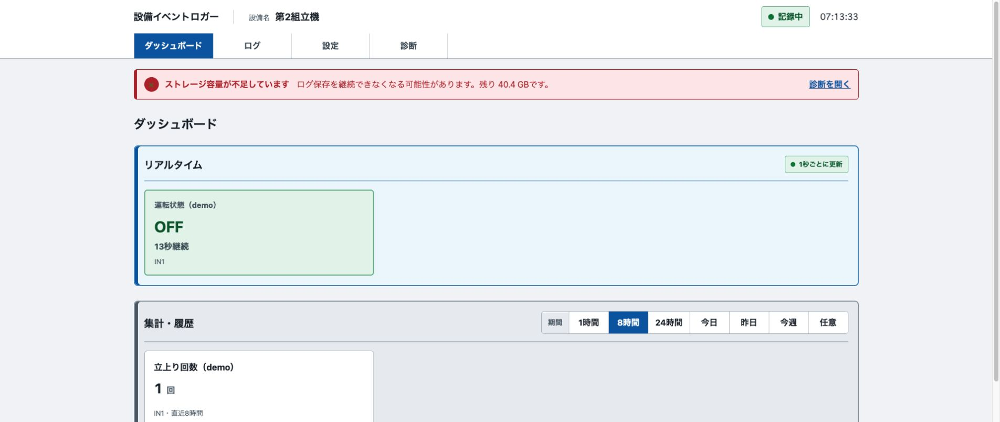

*0.1.6のデモ画面。状態、件数、容量警告は表示例です。*

### 3-2. 共通の表示期間

1. 「ダッシュボード」を開きます。
2. 集計・履歴の「1時間」「8時間」「24時間」「今日」「昨日」「今週」から期間を選びます。
3. 開始・終了を指定する場合は「任意」を選び、日時を入力して「期間を適用」を押します。
4. 各表示項目に表示された期間を確認します。

| 選択 | 対象期間 |
|---|---|
| 1時間・8時間・24時間 | 現在時刻から遡った期間 |
| 今日・昨日・今週 | 設定したタイムゾーンに基づく暦期間 |
| 任意 | 入力した開始日時から終了日時まで |

開始は終了より前に指定します。日時の基準は「本体・データ」のタイムゾーンです。

### 3-3. 表示項目固有の期間

**共通期間と表示項目の関係**

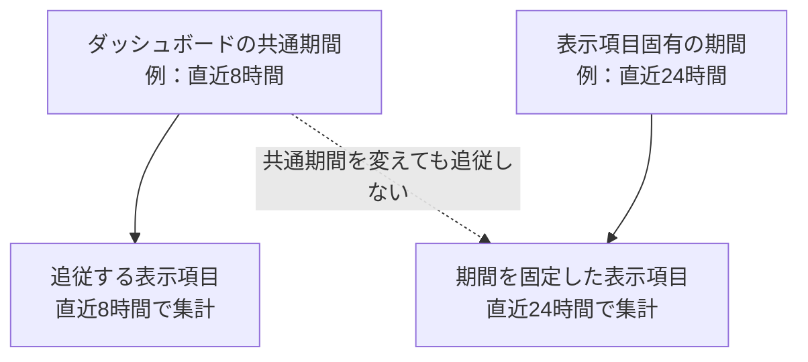

表示項目の「期間」が「ダッシュボードに追従」なら、共通期間に従います。「直近1時間」「直近8時間」「直近24時間」「直近7日」「直近30日」を指定した項目は、共通期間を変更してもその期間を維持します。

「今日」「昨日」「今週」を項目固有に指定した場合も、設定したタイムゾーンの暦期間になります。

**表示項目固有の「任意期間」の制約：** 表示項目の個別設定にある「任意期間」には、開始・終了日時の入力欄がありません。新規設定では、直近4時間の固定期間として扱われます。開始・終了を指定する場合は、表示項目を「ダッシュボードに追従」に設定し、共通期間の「任意」で指定してください。

### 3-4. 期間を変更した後の確認

例えば「今日」を指定すると、共通期間に追従するイベント回数・ON/OFF時間などは、設定されたタイムゾーンでの当日分を表示します。項目ごとに「直近24時間」などの固定期間を指定している場合、その項目には共通期間の変更が反映されません。

**期間の確認手順：** 共通期間を変更した後、対象カードの表示期間も確認してください。同じダッシュボードにあるカードでも、個別に期間を固定している場合は集計範囲が異なります。

### 3-5. 現在状態

| 設定 | 内容 |
|---|---|
| 対象信号 | 一つのIN |
| ON表示文字・OFF表示文字 | 例：「運転中」「停止中」。記録自体はON/OFFのまま |
| 継続時間 | 現在の状態が続いている時間を表示／非表示 |

記録停止中や監視できない場合はUNKNOWNになります。継続時間は、監視できた区間の情報です。

### 3-6. イベント回数とリセット

**3種類のカウント範囲**

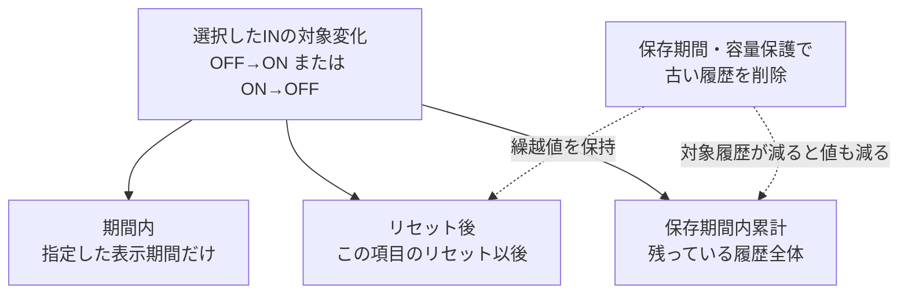

| 設定 | 内容 |
|---|---|
| 数える変化 | OFF→ON、またはON→OFF |
| カウント方式 | 期間内／リセット後／保存期間内累計 |
| 単位文字 | 表示する単位。例：「回」「個」。12文字以内 |

OFF→ONを指定した場合、OFFからONに変わるたびに1回と数えます。その後ONからOFFに戻っても、回数は増えません。記録開始時の状態保存は、変化の回数に含めません。

| 方式 | 集計範囲・保存期間による影響 |
|---|---|
| 期間内 | 指定した表示期間内の対象変化を数える |
| リセット後 | この表示項目をリセットしてからの対象変化を数える。古い履歴が保存期間で削除されても繰越分は維持される |
| 保存期間内累計 | 現在保存されている対象履歴全体を数える。古い履歴が削除されると減る場合がある |

**リセット手順：** ダッシュボードの対象項目で「リセット」を押し、確認画面の項目・現在値・リセット後の値を確認して実行します。対象項目だけがゼロを基準に数え直します。過去の入力履歴は変更・削除しません。

リセット後カウントの対象IN・変化方向を編集した場合は、保存時点から新しい集計基準になります。複製した表示項目は、元の項目のリセット基準・繰越値を引き継ぐものではありません。

### 3-7. ON/OFF時間

**状態不明を除く時間集計（例）**

この例の表示期間は30秒ですが、ON合計は17秒、OFF合計は5秒です。UNKNOWNの8秒は、どちらにも加算しません。

| 設定 | 内容 |
|---|---|
| 合計する状態 | ONまたはOFF |
| 表示単位 | 時間・分・秒／hh:mm:ss／分／時間（小数） |
| 期間 | 共通期間に追従、または項目固有の期間 |

ミリ秒（ms）の計測値は小数点以下1桁で表示します。例：886.199951171875ミリ秒は886.2ミリ秒と表示します。表示の丸めは、保存する時刻や集計値の精度を変更しません。

表示期間内で指定状態だった時間を合計します。期間境界をまたぐ状態は、対象期間と重なる部分だけを合計します。UNKNOWN区間は加算しません。したがって、ON時間とOFF時間の合計が表示期間全体より短い場合があります。

### 3-8. 最終イベント

「対象の変化」でOFF→ONまたはON→OFFを選びます。「絶対時刻」「経過時間」の表示を個別に切り替えられます。

指定期間内で対象の変化が最後に記録された時刻を表示します。対象の変化がない場合は、別方向の変化や記録開始時の状態を代用しません。

### 3-9. 経過時間

| 基準 | 設定・動作 |
|---|---|
| 指定状態から | ONまたはOFFを指定し、その状態の開始からの時間を表示 |
| 指定イベントから | OFF→ONまたはON→OFFを指定し、対象イベントからの時間を表示 |

対象の状態・イベントを確認できない場合は、確定値として表示できません。停止区間を含む時間を、連続監視した時間と同じ意味で解釈しないでください。

### 3-10. タイムライン

一つ以上のIN・OUTを選び、同じ時間軸に状態を表示します。ON、OFF、UNKNOWNを区別できます。

1. 共通期間または項目固有の期間を選びます。
2. 「＋」「−」で1倍・1.5倍・2倍に拡大縮小します。
3. 拡大時はタイムライン下部の共通スクロールバーで、全信号を一緒に横方向へスクロールします。信号名は左側に固定されます。
4. 区間・イベントにマウスポインターを合わせるか、タップして、信号名・状態・時刻などの詳細を確認します。
5. 履歴を一覧で確認する場合は「ログで詳しく見る」を押します。

データ量が大きく詳細表示を省略する旨の警告が出た場合は、期間や対象信号を減らします。表示の省略は、保存済みログの削除ではありません。

OUTの履歴はロガーが指示・記録した出力状態です。接続先の負荷が実際に動作したことを計測する機能ではありません。

### 3-11. イベント一覧

対象のIN・OUTを複数選択できます。表示件数は5・10・20件、状態は「ONとOFF」「ONのみ」「OFFのみ」から選びます。指定期間の最近の記録を表示します。

さらに絞り込む場合やCSVに保存する場合は「ログ」画面を使用します。

### 3-12. 用途別の設定例

以下は、**IN1がONのとき設備が運転中、OFFのとき停止中**となる信号を接続した場合の例です。実際の信号の意味は接続先設備の仕様によって異なります。第4-2節に従いIN1を「使用中」にし、安全な方法で実際のON/OFF変化が記録できることを確認してから設定してください。

#### 例1：設備が現在運転しているか確認する

1. 「設定」→「ダッシュボード」を開き、「リアルタイム」の「表示項目を追加」を押します。
2. 「現在状態」を選び、対象信号に「IN1」を指定します。
3. タイトルを「運転状態」、ON表示文字を「運転中」、OFF表示文字を「停止中」に設定します。
4. 「追加」を押し、設定画面の「変更を保存」を押します。
5. ダッシュボードで表示を確認し、実際の設備状態と一致しているかを確認します。

この表示はIN1の信号状態を示します。設備全体の安全状態や正常・異常を判定する機能ではありません。記録を停止している区間はUNKNOWNになります。

#### 例2：今日の運転開始回数を確認する

1. 「設定」→「ダッシュボード」で「集計・履歴」の「表示項目を追加」を押します。
2. 「イベント回数」を選択し、対象信号を「IN1」、タイトルを「運転開始回数」とします。
3. 数える変化を「OFF→ON」、カウント方式を「期間内」、期間を「ダッシュボードに追従」に設定します。
4. 「追加」後、「変更を保存」を押します。
5. ダッシュボードの共通期間を「今日」にして、対象カードの値と期間を確認します。

これで、**今日のOFF→ON変化回数**を表示します。運転開始とOFF→ONが一対一に対応している場合の例であり、生産個数や製品の完成回数を直接数えるものではありません。開始時の状態保存は回数に含まれません。毎日ゼロを起点として表示したい場合は「期間内」を利用します。履歴の保存期間による影響は第3-6節を参照してください。

#### 例3：今日の運転時間を確認する

1. 「設定」→「ダッシュボード」で「集計・履歴」から「ON/OFF時間」の表示項目を追加します。
2. 対象信号を「IN1」、合計する状態を「ON」、期間を「ダッシュボードに追従」に設定します。
3. タイトル（例：「運転時間」）と表示単位を確認して「追加」し、「変更を保存」を押します。
4. 共通期間を「今日」にし、ON時間の合計を確認します。

これはIN1がONと確定していた時間の合計です。電源OFF、明示的な記録停止などのUNKNOWN区間は加算しません。「今日」の集計値が設備の通電時間、稼働率、良品の加工時間と必ず一致するわけではありません。

**例1〜3の設定が反映されない場合：** 「変更を保存」を押し忘れていないか、対象INが「未使用」になっていないか、表示期間が固定されていないかを確認してください。表示項目がなくても、使用中の入力の記録は独立して行われます。

## 4. 設定画面

「設定」タブの中に、ダッシュボード・入力信号・出力動作・本体・データの4つのページがあります。設定する対象に合わせてページを開いてください。

### 4-1. ダッシュボード設定

画面上のカードを「表示項目（ウィジェット）」と呼びます。表示設定は入力の配線や出力の条件設定とは独立しています。

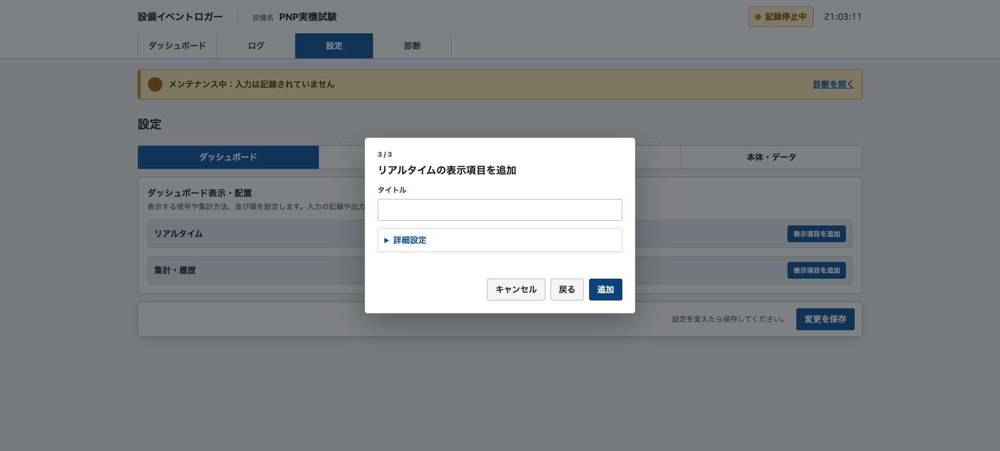

*0.1.6で撮影した画面。名称、日時、件数、状態は表示例です。*

*実機画面。タイトル未入力の状態です。*

#### 4-1-1. 表示項目を追加する

**追加設定の確定と保存**

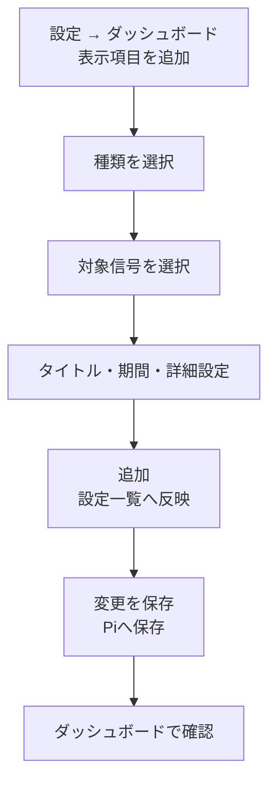

例：IN1の現在状態を表示する場合。

1. 「設定」→「ダッシュボード」を開きます。
2. 「リアルタイム」の「表示項目を追加」を押します。
3. 「現在状態」を選び、「次へ」を押します。
4. 対象のINを選び、「次へ」を押します。
5. タイトルを入力します（1〜200文字）。例：「運転状態」。
6. 「詳細設定」でON表示文字、OFF表示文字、継続時間の表示を設定します。
7. 「追加」を押します。
8. 設定画面の「変更を保存」を押します。
9. 「ダッシュボード」に戻り、対象信号と表示内容を確認します。

イベント回数などを追加する場合は、「集計・履歴」の「表示項目を追加」から種類を選びます。タイムライン・イベント一覧は、INとOUTを複数選択できます。それ以外は一つのINを選択します。

#### 4-1-2. 編集・複製・削除・非表示

| 操作 | 手順・結果 |
|---|---|
| 編集 | 対象の「編集」を押し、信号・タイトル・詳細設定を変更して「変更」を押します。その後、「変更を保存」を押します |
| 複製 | 対象の「複製」を押します。複製した項目のタイトル・信号・設定を編集し、「変更を保存」を押します |
| 削除 | 対象の「削除」を押し、確認画面で確定します。その後、「変更を保存」を押します |
| 非表示 | 表示スイッチを非表示にして「変更を保存」を押します。表示項目の設定は保持されます |

表示項目の削除や非表示では、入力履歴は削除されません。ダイアログの「キャンセル」は、そのダイアログの編集を取り消します。設定一覧へ反映した変更は、画面下の保存操作まで完了してください。

#### 4-1-3. 並び順と表示幅

「↑」「↓」で移動するか、行左端の「⋮⋮」をドラッグして並べ替えます。「表示幅」は小・中・大から選択します。最後に「変更を保存」を押します。

スマートフォンなど画面が狭い端末では、表示幅の指定にかかわらず縦に配置される場合があります。

### 4-2. 入力信号設定

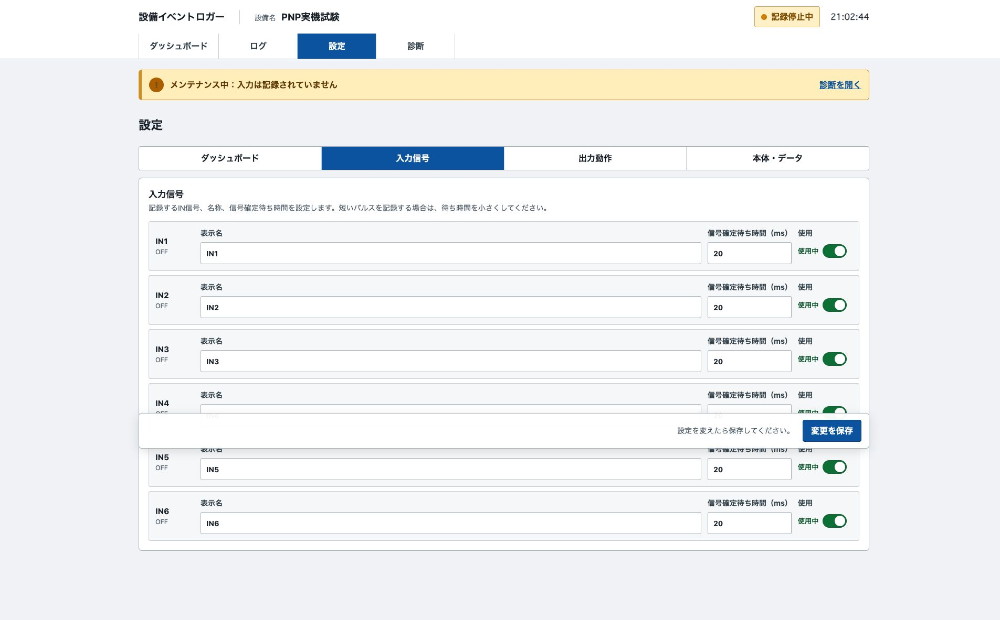

*0.1.6で撮影した画面。名称、日時、件数、状態は表示例です。*

#### 4-2-1. 設定手順

1. 「診断」で記録を停止します。
2. 「設定」→「入力信号」を開きます。
3. 使用する入力を「使用中」、使用しない入力を「未使用」にします。
4. 表示名（40文字以内）と信号確定待ち時間を入力します。
5. 「変更を保存」を押します。
6. 「診断」で設定反映が「一致」していることを確認します。
7. 記録を再開し、対象入力の状態とログを確認します。

未使用の入力は監視・記録しません。その入力を使用する条件ルールも、有効化前に入力設定を確認してください。入力を有効にした時点の状態保存は、信号が変化したという意味ではありません。

#### 4-2-2. 信号確定待ち時間

**新しい状態を確定する条件**

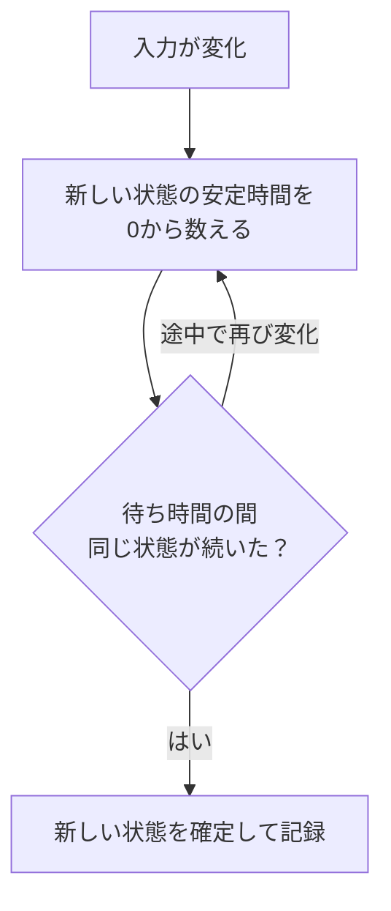

設定範囲は0〜5000ms、初期値は20msです。20msは0.02秒です。

新しい状態が指定時間連続して安定したときに確定します。途中で状態が変わると、安定時間を数え直します。単に変化直後の一定時間を無視する方式ではありません。

短いパルスを記録する場合は、信号の幅に合わせます。0msはこの安定待ちを設けない設定です。待ち時間を小さくするとノイズも記録されやすくなるため、設備の信号仕様に合わせて設定してください。

GPIO番号と電気的極性は対応基板に合わせて固定されています。利用者が設定する項目ではありません。

### 4-3. 出力動作設定

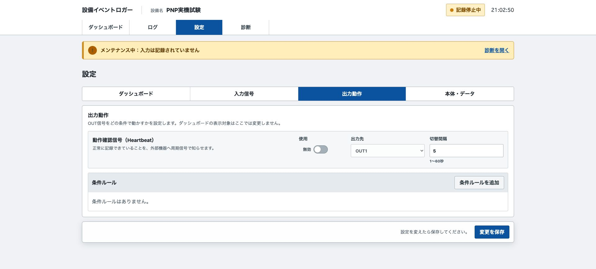

*0.1.6で撮影した画面。名称、日時、件数、状態は表示例です。*

#### 4-3-1. 出力の割当て

各OUTには、「未使用」「Heartbeat」「条件ルール（1件）」のいずれかを割り当てます。同じOUTを複数の用途には使用できません。無効に設定されている条件ルールも、出力先OUTの重複確認に含まれます。別用途へ割り当てる場合は、元のルールを削除するか出力先を変更します。

出力設定はダッシュボードの表示設定とは別です。OUTの履歴を表示する場合は、タイムラインまたはイベント一覧へ対象OUTを追加します。

#### 4-3-2. Heartbeat

1. 記録を停止します。
2. 「設定」→「出力動作」を開きます。
3. 「動作確認信号（Heartbeat）」の使用を有効にします。
4. 空いている出力先と切替間隔を指定します。
5. 「変更を保存」を押し、診断で設定一致を確認します。
6. 記録を再開し、指定OUTと履歴を確認します。

切替間隔は1〜60秒の整数です。5秒の場合、約5秒ごとにON/OFFを切り替え、1周期は約10秒になります。記録停止中は通常のHeartbeatを出力しません。安全機能や故障の完全な検出には使用できません。

#### 4-3-3. 条件ルールを追加する

1. 記録を停止し、「設定」→「出力動作」を開きます。
2. 「条件ルールを追加」を押します。
3. 次の項目を入力します。
4. ダイアログの「保存」を押します。
5. 一覧と診断の設定反映を確認します。
6. 記録を再開し、対象入力・出力の動作とログを確認します。

| 項目 | 内容 |
|---|---|
| ルール名 | 40文字以内 |
| 条件 | 指定状態が続いたら／指定イベントが発生しなかったら |
| 入力信号 | 一つの使用中IN |
| 状態・対象イベント | 状態条件ではON/OFF、未発生条件ではOFF→ON／ON→OFF |
| 時間・単位 | 1〜86400の整数、秒・分・時間 |
| 出力先 | 他の用途へ割り当てていないOUT |
| 有効・無効 | このルールを動作させるか |

**条件ルールの「保存」、有効・無効の切り替え、削除は、操作した時点でそれぞれ保存されます。** 入力、Heartbeat、本体、表示項目の「変更を保存」とは保存のタイミングが異なります。出力設定は、記録停止中に操作してください。

#### 4-3-4. 条件ごとの動作

**状態継続条件（例：IN1のOFFが5分継続）**

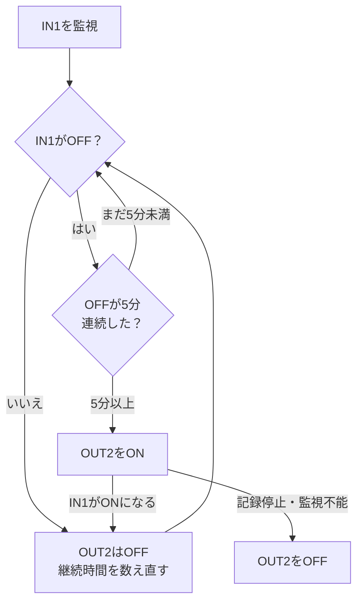

| 条件 | ONになる条件 | OFFへ戻る条件 |
|---|---|---|
| 指定状態が続いたら | 指定したONまたはOFFが、指定時間連続したとき | 指定状態でなくなったとき、監視できなくなったとき、記録を停止したとき |
| 指定イベントが発生しなかったら | 対象方向の変化が指定時間発生しなかったとき | 対象方向の変化が発生したとき、監視できなくなったとき、記録を停止したとき |

例：IN1のOFFが5分続いたらOUT2をONにする場合、IN1がONになるとOUT2はOFFへ戻ります。未発生条件でOFF→ONを選んだ場合、ON→OFFは待ち時間をリセットするイベントになりません。

未発生条件は、監視開始後に対象イベントが一度もなくても、監視開始から待ち時間を数えます。再開・設定反映などで監視基準が変わった場合は、新しい基準から判定します。停止中の時間を条件成立の根拠にはしません。

**イベント未発生条件（例：OFF→ONが5分発生しない）**

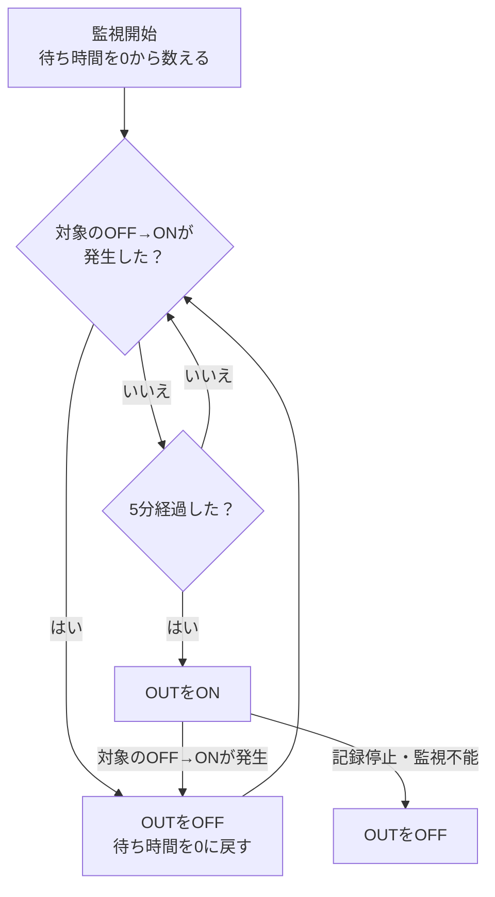

#### 4-3-5. 設定例：IN1のOFFが5分続いたらOUT2をON

この例は、IN1のOFF状態が5分間続いたことをOUT2で通知する設定です。設備の運転停止信号を監視する用途を想定していますが、**OUT2を安全制御・非常停止・安全インターロックに使用してはいけません。** OUT2のONによって接続先機器が何をするかを事前に確認し、接続先設備を安全な状態にしてください。

1. 診断画面で記録を停止し、メンテナンス状態を確認します。
2. 「設定」→「出力動作」から「条件ルールを追加」を押します。
3. 条件を「指定状態が続いたら」、入力信号を「IN1」、状態を「OFF」、時間を「5分」に設定します。
4. 他の用途に割り当てていない「OUT2」を出力先に指定し、ルール名（例：「運転停止5分通知」）を入力して有効にします。
5. 「保存」を押し、一覧に設定内容が表示されたこと、診断画面で設定反映が一致していることを確認します。
6. 記録を再開します。設備の担当者が安全を確保したうえで、IN1の状態とOUT2の動作、出力履歴を確認します。

IN1のOFF状態が5分間続くとOUT2のONを指示し、IN1がONに変わるとOUT2をOFFに戻す条件です。記録停止・監視不能の場合も通常出力はOFFになります。画面の出力履歴は出力指示の記録であり、接続先の実動作を検証した結果ではありません。

#### 4-3-6. ルールの編集・無効化・削除

- 編集：対象ルールの「編集」を押し、変更して「保存」を押します。
- 無効化：一覧の有効・無効スイッチを切り替えます。設定を残したまま動作を無効にします。
- 削除：対象ルールの「編集」を開き、「削除」を押します。削除はその場で保存されます。再使用する場合は追加し直します。

操作後、一覧と診断の設定反映を確認してください。出力の履歴は、ルールを削除しても通常の保存期間内は残ります。

出力テストは[6-3. OUTをテストする](#6-3-outをテストする)を参照してください。

### 4-4. 本体・データ設定

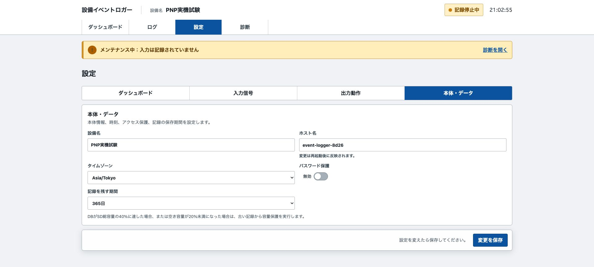

*0.1.6で撮影した画面。名称、日時、件数、状態は表示例です。*

「設定」→「本体・データ」で設定を変更し、「変更を保存」を押します。保存後は画面を再読み込みし、保存済みの値を確認します。

#### 4-4-1. 設備名・ホスト名・タイムゾーン

| 項目 | 設定内容・反映 |
|---|---|
| 設備名 | 画面で設備を識別する名称。40文字以内 |
| ホスト名 | LAN上のPiの名称。63文字以内の英小文字・数字・ハイフン。先頭・末尾は英小文字または数字。再起動後に反映 |
| タイムゾーン | Asia/TokyoまたはUTC。日時表示・暦期間・CSVの日時に使用 |

ホスト名と設備名は別の項目です。ホスト名を変更した場合は、Piを再起動して、新しいホスト名またはIPv4アドレスで接続できることを確認します。タイムゾーンを変更しても、保存済み入力記録の発生時刻そのものは書き換えません。

#### 4-4-2. 共有パスワード

1. パスワード保護を有効にします。
2. 初めて有効にする場合、または変更する場合は共有パスワードを入力します。入力文字は伏せず表示されるので、保存前に内容を確認してください。
3. 「変更を保存」を押します。
4. ログイン画面が表示された場合は、設定したパスワードで接続します。

共有パスワードを変更すると、変更した端末を含むすべての端末でログインし直す必要があります。保護を無効にしてから再び有効にした場合も同様です。ソフトウェア更新や本体再起動などでWeb画面の処理が再起動した場合も、共有パスワードでログインし直してください。

設定済みパスワードを維持する場合は、パスワード欄を空のまま保存します。無効にする場合は、パスワード保護を無効にして保存します。

個人別の利用者アカウントや権限分けはありません。保護を有効にしてもHTTP通信は暗号化されません。PiのSSHパスワードはこの画面では変更できません。

#### 4-4-3. 記録の保存期間

30・90・180・365・730・1825日、または無期限を選択します。初期値は365日です。

期間を短縮すると、古い履歴が削除対象になります。必要な履歴を先にCSVで保存してください。期間を延長しても、削除済みの履歴は戻りません。

#### 4-4-4. 容量保護

空き容量が30%未満になると容量警告を表示します。

DBがSD総容量の40%に達した場合、または空き容量が20%未満の場合は、古い記録から容量保護処理を実行します。「無期限」は、容量保護による削除を無効にする設定ではありません。

保存期間や容量保護で古い記録が削除されると、過去のログや保存期間内累計は変化します。リセット後カウントは繰越分を保持します。設定した日数分を、SD容量にかかわらず必ず保存する保証ではありません。

## 5. ログ画面

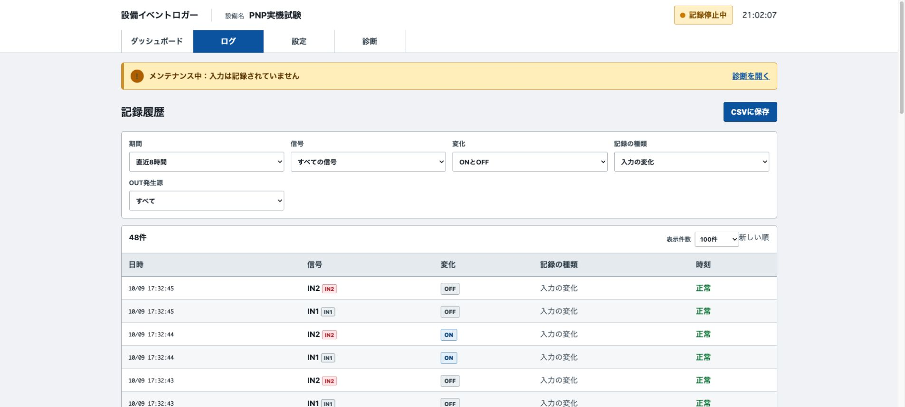

*0.1.6で撮影した画面。名称、日時、件数、状態は表示例です。*

### 5-1. 条件を指定して検索する

「ログ」を開き、次の条件を設定します。条件を変更した後、対象件数と表示行を確認します。

| 項目 | 選択内容 |
|---|---|
| 期間 | 直近1・8・24時間、今日、昨日、今週、任意期間 |
| 信号 | すべて、またはIN1〜IN6・OUT1〜OUT6の対象信号 |
| 変化 | ONとOFF、ONのみ、OFFのみ |
| 記録の種類 | 入力の変化、記録開始時の状態、出力の記録、すべて |
| OUT発生源 | すべて、条件ルール、Heartbeat、動作テスト、起動時OFF |
| 表示件数 | 1ページ50・100・500件 |

任意期間は開始・終了日時を入力して「期間を適用」を押します。表示は新しい順です。「前へ」「次へ」でページを移動します。

「記録開始時の状態」は、その時点の状態を保存した行です。ON/OFF変化が発生した行とは区別します。OUT発生源の条件は、出力履歴の確認に使用します。

### 5-2. CSVに保存する

**検索結果とCSVの出力範囲**

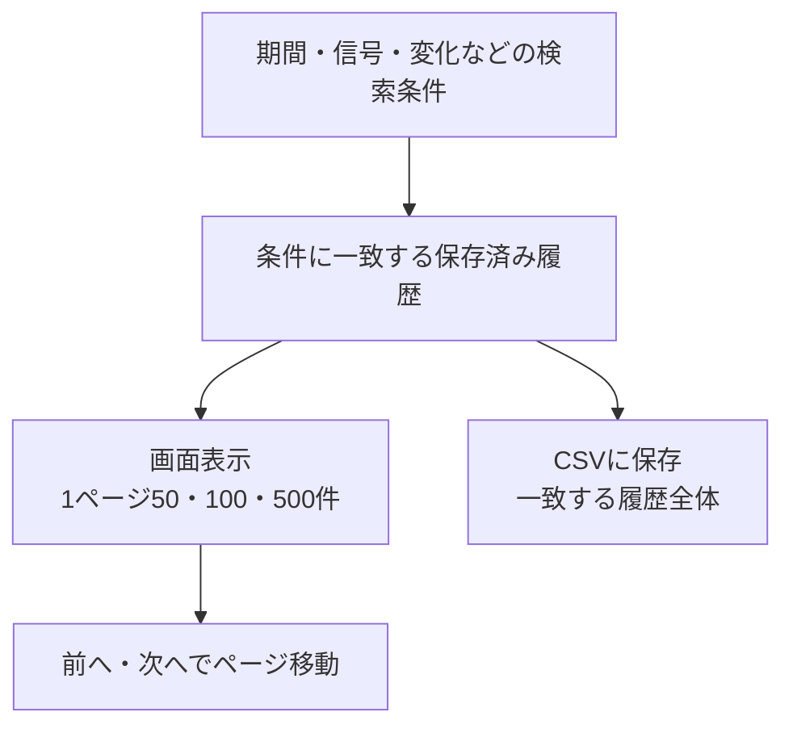

1. 期間・信号・変化・記録種類・OUT発生源を設定します。
2. 対象件数と表示行を確認します。
3. 「CSVに保存」を押します。
4. 閲覧端末のダウンロード一覧で`events.csv`を確認します。
5. Excel等で開き、対象信号・日時・行数を確認します。

CSVは、画面の1ページではなく検索条件に一致する履歴を出力します。大量の履歴で保存に時間がかかる場合は、期間を分けて保存します。日本語が文字化けする場合は、表計算ソフトのCSV読込み機能でUTF-8を指定します。

#### 5-2-1. 検索と保存の例：今日のIN1の変化

1. 「ログ」を開き、期間を「今日」、信号を「IN1」に設定します。
2. 変化を「ONとOFF」、記録の種類を「入力の変化」に設定します。
3. 対象件数と、画面に表示されている日時・信号・ON/OFFを確認します。
4. 「CSVに保存」を押し、保存した`events.csv`を開いて対象の行を確認します。

この検索では記録開始時の状態保存（snapshot）は入力の変化に含めません。記録開始時の状態も必要な場合は、記録の種類を「すべて」など目的に合う条件へ変更してください。検索結果が0件の場合は、該当期間に検索条件と一致する履歴がないことを示します。直ちに記録装置の故障と判断せず、期間、入力の使用状態、記録状態、実際の信号変化の有無を確認します。

**CSVの保管：** 保存先は操作中のPC・スマートフォン側です。Pi上のDBが自動的に別媒体へバックアップされるわけではありません。必要に応じて管理対象の保存先へ移し、ファイル名に設備名・対象期間を付けるなどして取り違えを防いでください。

### 5-3. CSVの列を読む

CSVはUTF-8 BOM付きです。

| 列名 | 内容 |
|---|---|
| timestamp | 設定したタイムゾーンによる日時 |
| signal | IN1〜IN6、OUT1〜OUT6 |
| name | 出力時点の入力名、または出力の名称 |
| value | ONまたはOFF |
| kind | edge：入力変化、snapshot：状態保存、output：出力記録 |
| source | 出力発生源。rule・heartbeat・test・startup。入力では空欄 |
| clock_synced | 記録時に時刻同期を確認できたか。true／false |

入力名・ルール名はCSV出力時点の名称です。過去の記録時に使われていた名称を保存する履歴ではありません。`clock_synced=false`の記録は時刻の確実性を別途確認します。

CSVを保存してもPiの履歴は削除されません。CSVから設定やデータベースを復元する機能はありません。

### 5-4. 時刻が「要確認」の記録

1.0.1では、記録時の時刻同期状態をログ表の「時刻」欄で確認できます。「要確認」の行は記録時点で時計が未同期だった可能性があります。現在の時計が同期済みでも、その行の発生時刻が正確とは限りません。後から同期しても記録時刻は自動修正されません。CSVではclock_synced列も確認してください。

## 6. 診断画面

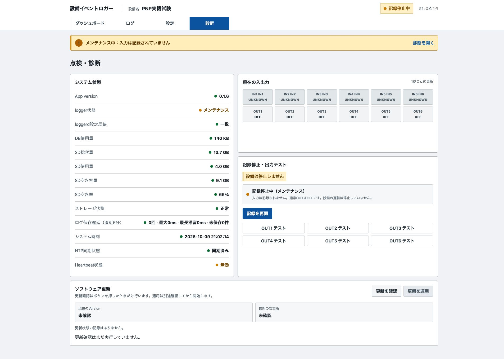

*0.1.6で撮影した画面。名称、日時、件数、状態は表示例です。*

### 6-1. システム状態を確認する

| 項目 | 確認内容 |
|---|---|
| App version | 使用中のソフトウェアのバージョン |
| 記録・動作状態 | 記録中、メンテナンス、異常、通信不能など |
| 設定反映 | Web側の設定と記録処理側の設定が一致しているか |
| DB・SD容量 | DB使用量、SD容量、空き容量・割合、容量警告 |
| 保存状態 | 未保存件数、保存待ち時間、直近の保存遅延 |
| システム時刻・NTP | 日時と時刻同期の状態 |
| Heartbeat | 有効・無効、使用OUT、動作状態 |

保存待ちの件数が増え続ける場合は、正常に保存されているとは判断できません。電源を切らず、件数・待ち時間・エラーを確認します。

NTPと同期していない場合も記録には時刻が付きますが、その時刻が正確である保証はありません。CSVの`clock_synced`も確認してください。

1.0.1では、時計が未同期だった記録が残っている場合に「同期前の記録があります」と表示されます。ログ画面の「要確認」の行とCSVのclock_synced列で、対象の記録を確認してください。

### 6-2. 記録を停止・再開する

**記録・メンテナンス・出力テストの遷移**

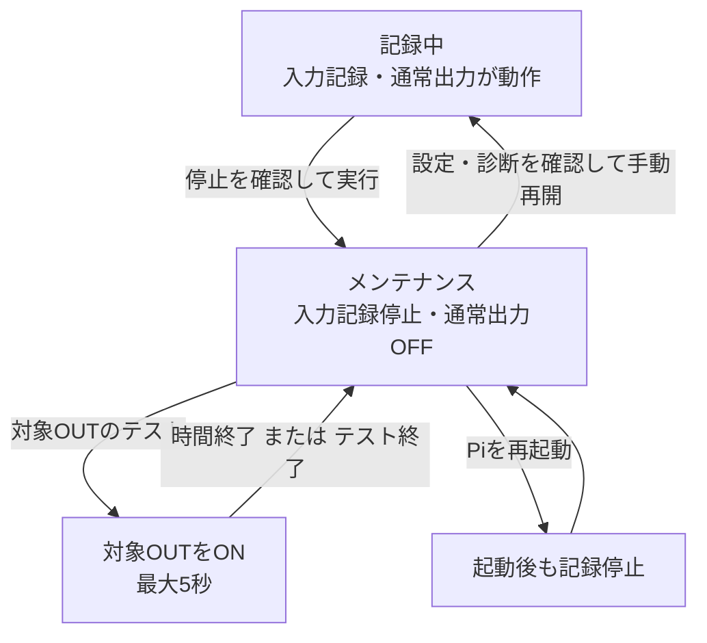

#### 6-2-1. 記録状態を確認する

画面上部の「記録中」「記録停止中」と、診断画面の動作状態を確認します。ブラウザに接続できない場合は、画面から現在の記録状態を確認できません。

記録開始時には、使用中の入力の状態を保存します。その後は確定したON/OFF変化を保存します。状態が変わらない間は、入力変化の記録は増えません。

#### 6-2-2. 記録を停止する

1. 「診断」を開きます。
2. 「記録停止・出力テスト」の「記録を停止して出力テストへ」を押します。
3. 確認画面で「記録を停止」を押します。
4. 画面上部が「記録停止中」、動作状態がメンテナンスになったことを確認します。

停止中は新しい入力を記録しません。通常のHeartbeatと条件出力はOFFになります。停止区間は状態不明として扱います。設備そのものの停止操作ではありません。

#### 6-2-3. 記録を再開する

1. 「診断」で、設定反映や保存状態に問題がないことを確認します。
2. 「記録を再開」を押します。
3. 画面上部が「記録中」になったことを確認します。

再開時の入力状態から、新しい監視区間が始まります。条件出力の待ち時間も新しい監視区間を基準に数えます。停止中の変化を遡って記録することはできません。

明示的に停止した記録は、Piの再起動後も停止したままです。設定不一致などで再開できない場合は、第6章を参照してください。

### 6-3. OUTをテストする

1. 接続先を、対象OUTがONになっても問題のない状態にします。
2. 「診断」で記録を停止し、メンテナンス状態を確認します。
3. 対象番号を確認し、「OUT1 テスト」などを押します。
4. 最大5秒で対象OUTがOFFへ戻ることを確認します。
5. 途中で終了する場合は、表示された「テスト終了」を押します。
6. テスト後も記録は停止しています。必要な場合は「記録を再開」を押します。

記録中には出力テストを実行できません。テスト終了後に自動で記録を再開することはありません。画面の出力履歴は、接続先の動作を保証する計測結果ではありません。

### 6-4. ソフトウェアを更新する

#### 6-4-1. 更新条件

Piからインターネットへ接続でき、更新先が設定されている必要があります。導入時の更新先設定は[インストール説明書](インストール説明書.md#7-5-web更新の配布元設定)を参照してください。

更新中はソフトウェアが停止するため、記録できない区間が発生します。必要な履歴をCSVで保存し、出力を使用する設備の状態を確認してから行います。

#### 6-4-2. 更新を確認・適用する

1. 「診断」のソフトウェア更新欄を開きます。
2. 「更新を確認」を押します。確認だけでは更新を開始しません。
3. 現在のバージョン、最新の安定版、更新内容を確認します。
4. 適用する場合は「更新を適用」を押し、確認画面を確定します。
5. 「処理中」の間は電源を切らず、「完了」または「失敗」が表示されるまで待ちます。進捗バーは処理中を示すもので、残り時間や割合を表すものではありません。画面はローカルの更新結果を自動確認します。切替中に一時的に通信できない場合も、再接続を待ちます。「結果未確認」は成功・失敗を判断できていない状態です。再適用せず、接続を確認してください。
6. 再接続後、App version、設定反映、記録状態、入力設定、過去のログを確認します。

更新対象は新しい安定版です。同じバージョン・古いバージョン・開発版に切り替える操作ではありません。OS更新はこの機能の対象外です。更新前に記録を停止していた場合は、完了後も停止状態を確認し、必要なときに手動で再開します。

#### 6-4-3. 失敗時の復帰

**更新と自動復帰の分岐**

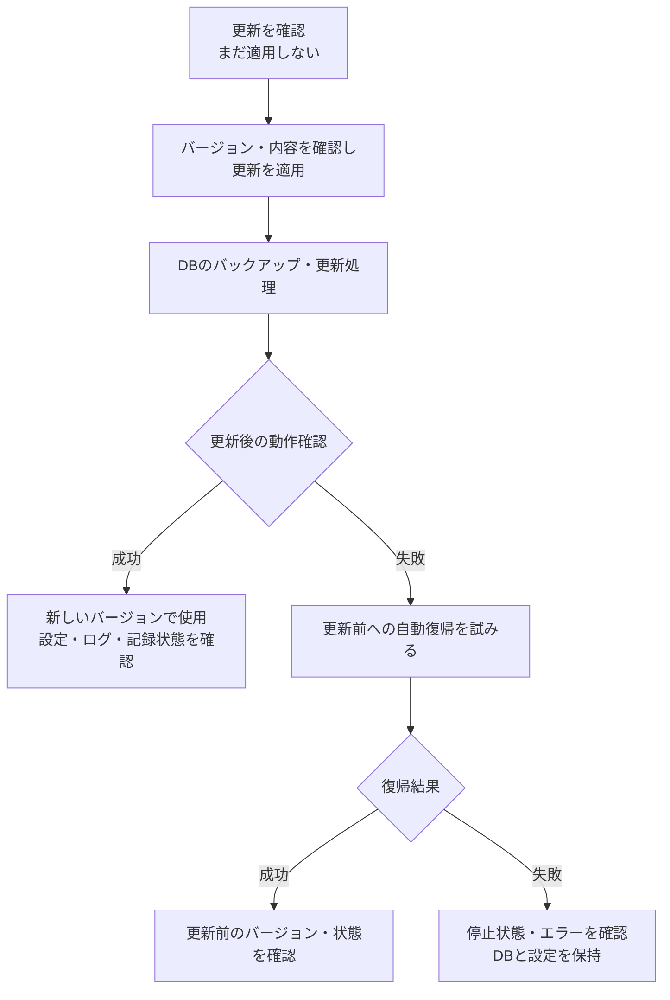

更新処理はデータベースのバックアップを作成し、更新後の動作確認に失敗した場合は更新前の状態への自動復帰を試みます。復帰にも失敗する可能性があります。

失敗時は、現在のバージョン・更新先のバージョン・更新状態・エラーを控えてください。現状のデータベースや設定を削除しないでください。Web画面には手動でDBを復元する機能はありません。CSVはDB復元用のファイルではありません。

### 6-5. 画面から本体を再起動する

診断の「本体を再起動」は常設です。更新先の設定がなくても利用できます。

1. 「本体を再起動」を押します。
2. 確認ダイアログの注意事項を読み、「再起動する」を押します。キャンセルすると再起動しません。
3. 1分ほど待って画面を再読み込みし、診断で記録状態を確認します。

再起動中は入力記録・出力が一時停止し、画面との接続が切れます。記録できない区間はUNKNOWNです。設備自体は停止しません。記録中なら起動後に記録を再開し、明示的に記録停止していた場合は停止状態を維持します。ソフトウェア更新中の再起動は受け付けません。デモ表示では実際には再起動しません。

### 6-6. 設定不一致や重大な異常

#### 6-6-1. 設定反映の不一致

1. エラー内容と、直前に変更した設定を確認します。
2. 記録状態・出力状態を確認します。OFFを確認できない旨の警告がある場合は、接続先も確認します。
3. 「設定を再読込」が表示されている場合は押します。
4. 設定反映の一致と警告解除を確認します。
5. 記録が停止している場合は、確認後に手動で再開します。

再読み込みは、保存済みの現在の設定を記録処理側へ再反映する操作です。初期化や履歴削除ではありません。再読み込みに失敗する場合は、再開操作を繰り返さず第8章の情報を確認してください。

#### 6-6-2. 保存失敗・重大異常

重大異常では記録停止や通常出力のOFF処理が行われる場合があります。異常停止（Critical）は、記録処理を再起動するまで画面の再開操作を受け付けません。画面に「停止」「異常」「通信不能」が表示された場合は、状態を確認して対処してください。通信不能時には、画面表示だけで実際のOUTがOFFと断定できません。

原因（容量不足、保存エラーなど）を解消した後、PiにSSH接続し、`sudo systemctl restart event-loggerd`を実行します。再接続して診断の状態・設定反映・未保存件数を確認し、必要な場合だけ記録を再開します。原因不明のまま再起動を繰り返さないでください。

### 6-7. 保存遅延の注意と警告

点検・診断では保存状態を「正常・注意・警告」で区別します。一時的な保存遅延は注意として診断画面だけに表示し、回数・最大遅延・未保存の最長滞留・件数を確認できます。注意だけでは記録欠損を意味しません。

未保存の最長滞留または保存処理が5秒以上、キュー使用量が80%以上、保存失敗の場合は画面タイトルより上の注意欄に警告します。電源を維持し、入力頻度・ストレージ容量・保存エラーを確認してください。未保存の記録は電源断で失われる可能性があります。回復条件を10秒維持してから警告が消えます。異常停止の場合は原因を解消してから既存の再起動手順を行ってください。

注意・警告は各画面のタイトルより上の共通欄にまとめ、同じ内容を重複表示しません。「対応方法を見る」で点検・診断を開くと、同じ欄に詳しい説明と対応方法が表示されます。一時的な保存遅延の注意は、点検・診断のタイトルより上にだけ表示します。

## 7. 電源を切る

### 7-1. 電源を切る前に確認する

必要な履歴をCSVで保存し、診断で未保存件数と記録状態を確認します。出力を接続している設備の状態を確認してから記録を停止してください。記録停止はRaspberry PiのOS終了ではありません。

### 7-2. SSHで電源停止・再起動する

記録停止はPiの電源停止ではありません。OSを終了してから電源を切ります。

1. 診断で記録を停止し、未保存件数と停止状態を確認します。
2. PCから、導入時のユーザー名・PiのIPv4でSSH接続します。
3. 再起動は`sudo reboot`、電源停止は`sudo shutdown -h now`を実行します。
4. 電源停止の場合は、Pi 5本体の電源ボタン横のランプが、動作中の緑から待機の赤へ変わったことを確認してから電源を切ります。
5. 再起動・次回起動後はブラウザに接続し、診断を確認して、必要なときに記録を再開します。

SSH接続を含む詳細手順は[インストール説明書 第10章](インストール説明書.md#10-電源停止再起動)を参照してください。SSHが切れただけではOS停止完了の確認にはなりません。[Pi 5のLEDの公式説明](https://www.raspberrypi.com/documentation/computers/configuration.html#raspberry-pi-5-and-500-leds)。

### 7-3. 停止操作と記録継続の区別

| 操作・状態 | 新しい入力の記録 | 補足 |
|---|---|---|
| ブラウザの画面を閉じる | 継続する | Piが動作して「記録中」であれば、画面を閉じても記録は継続する |
| 診断画面で「記録を停止」 | 停止する | 明示した停止状態は再起動後も維持される |
| Piをシャットダウンする | 停止する | 電源OFF中は監視できず、後から入力変化を復元できない |
| 記録を再開する | 再開後から記録する | 停止中に起きた変化を遡って補完しない |

停止の前後でログや集計値がどう扱われるかは第2-3節と第6-2節を参照してください。

### 7-4. 次に起動したとき

ブラウザで接続し、診断でApp version、設定反映、容量、時刻同期、入力状態を確認します。明示的に記録を停止していた場合は停止状態が維持されるため、確認後に必要な場合だけ「記録を再開」を押します。

## 8. 症状から探す

### 8-1. 症状と対処

| 症状 | 確認・対処 |
|---|---|
| 画面に接続できない | Piの電源、LAN接続、現在のIPv4、閲覧端末が同じLANかを確認 |
| ログが増えない | 記録中か、対象INが使用中か、信号が変化したか、信号が確定待ち時間より長く続いたかを確認 |
| UNKNOWNが表示される | 記録停止、未使用入力、監視不能を確認。OFFへ読み替えない |
| 回数が期待と違う | 対象IN、OFF→ON／ON→OFF、カウント方式、期間、リセット基準を確認 |
| 時間の合計が期間より短い | UNKNOWN区間、対象状態、期間境界を確認 |
| 出力が動かない | 記録中か、ルールが有効か、入力が使用中か、待ち時間、OUTの重複、設定反映を確認 |
| 条件ルールを追加できない | OUTの割当て、入力の有効状態、時間が1〜86400の整数かを確認 |
| 出力テストが押せない | メンテナンス状態か、別のテストが実行中か、通信・設定反映の警告がないかを確認 |
| 設定保存に失敗 | 表示エラーを確認。再読み込みで保存済みの値を確認し、診断の設定反映を確認 |
| SD容量の警告 | 必要な履歴をCSVで保存し、保存期間を見直す。OS内のファイルを無作為に削除しない |
| 未保存が増え続ける | 電源を維持し、保存件数・遅延・容量・エラーを確認 |
| 日時が合わない | タイムゾーン、システム時刻、NTP同期を確認 |
| CSVの文字化け | 表計算ソフトのCSV読込みでUTF-8を指定 |
| 更新先が未設定 | インストール説明書の更新先設定を実施 |
| 更新確認が通信エラー | Piのインターネット接続と配布元を確認 |
| 共有パスワードが不明 | OSのSSHパスワードとは別。設定時の管理記録を確認。OS再作成では履歴を失う |

問題の記録には、ソフトウェアのバージョン、発生日時、操作手順、表示されたエラー、入力・出力の設定、診断の状態を含めます。パスワード、Wi-Fi情報、設備の機密情報は含めません。

設定保存は複数の項目を順に処理するため、途中で失敗した場合にすべての変更が一括して取り消されるとは限りません。保存を繰り返す前に、再読み込みして各項目の保存済み値を確認してください。

### 8-2. 最初に見る画面

| 確認したいこと | 最初に見る画面・項目 | 続けて確認すること |
|---|---|---|
| 現在の状態表示が空、またはUNKNOWN | ダッシュボード、診断 | 記録中か、対象INが使用中か、設定反映が一致しているか |
| 回数が想定より少ない／多い | イベント回数の設定 | 変化方向、カウント方式、表示期間、リセット基準、実際の信号変化 |
| CSVに期待した行がない | ログの検索条件 | 期間、対象IN、変化、記録種類（edgeとsnapshotの違い） |
| OUTが反応しない | 出力動作のルール、診断 | IN状態、ルールの有効化、条件時間、OUT割当て、記録状態 |
| 再起動後に記録が動いていない | 診断の記録状態 | 停止状態が維持されていないか、異常停止や設定不一致がないか |

いずれの場合も、接続先の配線や設備側の状態を確認せずに入力設定・出力設定を変更しないでください。特に通信できない場合は、Web画面だけで実際のOUT状態を断定できません。

## 9. 用語

### 9-1. 基本用語

| 用語 | 意味 |
|---|---|
| IN・OUT | 基板の入力・出力。各6点 |
| イベント | 記録対象の入力変化など |
| ウィジェット | ダッシュボードに配置する表示項目 |
| メンテナンス | 記録を明示的に停止した状態。出力テストが可能 |
| Heartbeat | 外部機器へ出す周期的な動作確認信号 |
| NTP | ネットワークを利用する時刻同期 |
| DB | Pi内の記録・設定を保存するデータベース |
| CSV | 表計算ソフトで扱える履歴ファイル |
| SSH | PCからPiに接続してコマンドを実行する方法 |

### 9-2. 記録と集計の用語

| 用語 | 意味 |
|---|---|
| edge | 入力のON/OFF変化 |
| snapshot | 記録開始時などに保存する入力状態。変化の記録とは別 |
| UNKNOWN | 監視していない、または状態を確定できない区間 |
| リセット後カウント | 最後にリセットした時点以降の回数。古い履歴の削除時も繰越分を保持 |
| 保存期間内累計 | 現在DBに残っている履歴を使った回数 |
| clock_synced | 記録時に時刻同期を確認できたかを示すCSV列 |
