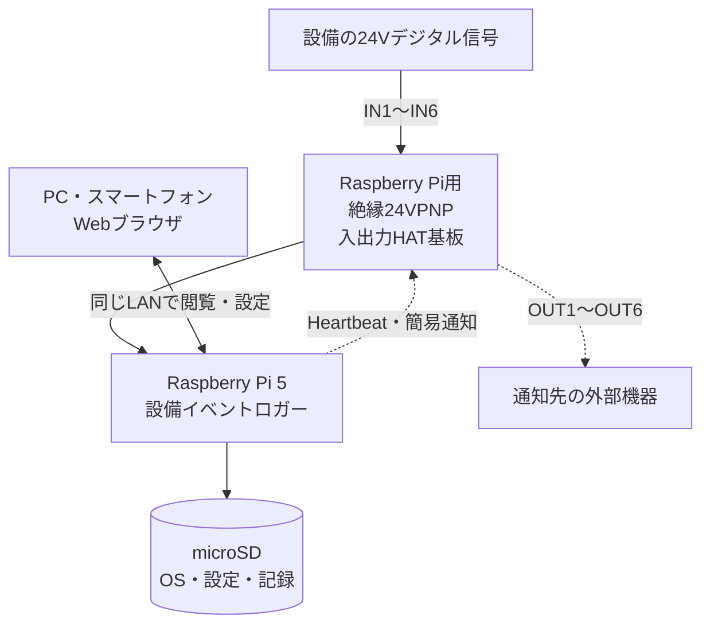
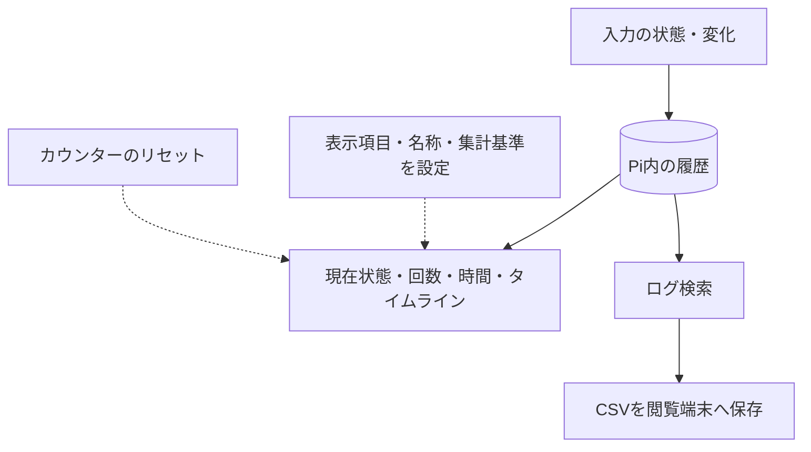

# 設備イベントロガー 概要説明書

対象ソフトウェア：24V Event Logger（公開安定版）

対応基板：らずぱい工房「Raspberry Pi用　絶縁24VPNP入出力HAT基板」

本書は、製品の用途、構成、使用条件を説明します。導入作業については[インストール説明書](インストール説明書.md)、画面操作と各機能については[取扱説明書](取扱説明書.md)を参照してください。

## 1. 製品概要

設備からの24Vデジタル信号のON/OFF変化を、発生時刻とともにRaspberry Piに記録するソフトウェアです。運転信号、完了信号、異常信号などの履歴を、同じLANに接続したPC・スマートフォンのブラウザで確認できます。

入力はIN1〜IN6の6点です。記録した履歴から、イベント回数、ON/OFF時間、最終イベント時刻などを表示し、CSVファイルとして保存できます。画面の表示項目は、用途に合わせて追加・配置できます。

出力はOUT1〜OUT6の6点です。動作確認用の周期信号（Heartbeat）と、指定した状態の継続やイベントの未発生に基づく簡易通知に使用できます。

ON/OFFの意味は、接続した設備の信号仕様によって決まります。例えば運転信号であればONを「運転中」と表示できますが、信号の意味をソフトウェアが自動判定するものではありません。

### 利用例：設備の運転状況を記録する

設備から「運転中はON、停止中はOFF」となる24V信号が出ている場合、その信号をIN1へ接続し、IN1を「使用中」に設定すると、次のように利用できます。

| 確認したいこと | Web画面での確認方法 |
|---|---|
| 現在、設備が運転しているか | 「現在状態」でIN1のON／OFFを表示する |
| 今日、何回運転を開始したか | 「イベント回数」でIN1のOFF→ONを選び、表示期間を「今日」にする |
| 今日、運転していた時間 | 「ON/OFF時間」でIN1のON時間を集計する |
| 何時に運転・停止したか | 「ログ」または「タイムライン」でIN1の変化履歴を見る |
| 記録を別のPCで確認したい | 「ログ」から対象期間を選び、CSVを保存する |

これは設定例です。ONが運転を意味するのは、そのような信号を設備が出している場合に限ります。また、運転開始回数が生産個数と一致するとは限りません。実際の信号の意味は設備の仕様・配線で確認してください。画面の具体的な設定手順は[取扱説明書](取扱説明書.md)を参照してください。

## 2. システム構成

**信号・記録・閲覧の関係**

記録と設定はRaspberry Pi内に保存します。クラウドへの登録や、閲覧端末への専用アプリのインストールは不要です。ブラウザを閉じても、Piが動作し記録中であれば記録は継続します。

### 導入から利用までの流れ

| 段階 | 実施する作業 | 参照先 |
|---|---|---|
| 導入前 | 対応するPi・HAT、設備信号、LAN環境の確認 | 本書 第3・6章 |
| 初回導入 | SDへのOS書き込み、Piの起動、ファイル転送、ソフトウェア導入 | [インストール説明書](インストール説明書.md) |
| 初回確認 | Web画面での入力設定、記録開始・ログ表示の確認 | インストール説明書 第8・9章 |
| 通常運用 | 表示項目の設定、履歴確認、CSV保存、点検 | [取扱説明書](取扱説明書.md) |

Raspberry Pi本体で画面を操作する必要はありません。導入時に使用したPCからPiに接続して設定を行い、導入後は同じLAN内のPC・スマートフォンのブラウザから利用します。

## 3. 使用環境・必要機器

| 項目 | 条件 |
|---|---|
| Raspberry Pi | Raspberry Pi 5、メモリー4GB以上 |
| 入出力基板 | らずぱい工房「Raspberry Pi用　絶縁24VPNP入出力HAT基板」 |
| OS | Raspberry Pi OS Lite 64-bit、Debian 13（Trixie） |
| microSD | OS・ソフトウェア・必要な記録量を保存できる容量。初回作成用のカードリーダーも必要 |
| 電源・配線 | Pi、基板、接続設備それぞれの定格を満たすもの |
| 導入用PC | Windows PCまたはMac。SD作成、ファイル転送、初回導入に使用 |
| 閲覧端末 | Piと同じLANに接続したPC・スマートフォンとWebブラウザ |
| ネットワーク | 有線LANまたはWi-Fi。初回導入・ソフト更新にはインターネット接続が必要 |

基板の正式名称・配線・電気定格は[らずぱい工房の公式商品ページ](https://raspikoubou.theshop.jp/items/92486466)を参照してください。基板単体の対応機種と、このソフトウェアの対応機種は異なります。本書で説明する構成はRaspberry Pi 5を対象とします。

プログラミングの知識は不要です。初回導入では、本書に対応するインストール説明書のコマンドを入力します。導入後の設定・記録の閲覧・CSV保存はブラウザで操作します。

ただし、初回導入にはPCでのファイル操作、ネットワーク接続、指定されたコマンドの実行が必要です。24V設備への配線は、接続先設備の仕様と電気的な安全条件を確認できる担当者が行ってください。この説明書は、設備ごとの配線設計や安全確認に代わるものではありません。

## 4. 主な機能

| 機能 | 内容 | 操作説明 |
|---|---|---|
| 入力記録 | 6入力のON/OFF変化と記録開始時の状態を保存 | 取扱説明書 第3・7章 |
| ダッシュボード | 現在状態、イベント回数、ON/OFF時間、最終イベント、経過時間、タイムライン、イベント一覧 | 取扱説明書 第4〜6章 |
| ログ・CSV | 期間・信号・変化・記録の種類・出力発生源による検索、CSV出力 | 第8章 |
| 簡易出力 | Heartbeat、状態継続条件、イベント未発生条件 | 取扱説明書 第9章 |
| 本体・データ設定 | 設備名、ホスト名、タイムゾーン、共有パスワード、保存期間 | 取扱説明書 第10章 |
| 点検・診断 | 記録停止・再開、出力テスト、容量・時刻・保存状態・設定反映の確認 | 取扱説明書 第3・11章 |
| ソフトウェア更新 | 安定版の確認・適用、失敗時の自動復帰処理 | 取扱説明書 第12章 |

## 5. 記録と集計の基本

**記録と表示の関係**

入力が一定のままなら、変化の記録は増えません。記録開始時にはその時点の状態を保存し、その後は確定したON/OFF変化を保存します。

記録を停止した時間、電源OFFの時間など、監視できなかった区間は「UNKNOWN（状態不明）」として扱います。状態不明はOFFではありません。ON/OFF時間の集計では、状態不明の時間をONまたはOFFに加算しません。

表示項目や入力名を変更しても、過去の入力記録は書き換えません。回数のリセットは、その表示項目の集計基準を変更する操作です。

## 6. 使用上の制約

- 非常停止、人身安全制御、安全インターロックには使用できません。出力の用途は動作確認・診断・簡易通知に限ります。
- 信号確定待ち時間より短い入力や、処理能力を超える信号を必ず記録できるとは限りません。
- SD故障、停電、保存待ちなどにより記録が失われる場合があります。必要な履歴はCSVで別の媒体へ保存してください。
- 保存期間を「無期限」にしても、容量保護により古い履歴が削除される場合があります。
- CSVは履歴の閲覧・分析用です。OS、設定、データベース全体を復元するバックアップではありません。
- Web画面には、ネットワーク経由でPiに接続できる端末からアクセスできます。パスワード保護が無効の場合や共有パスワードが第三者に知られた場合、第三者が記録を閲覧・CSV保存したり、記録を停止・設定を変更・出力テストを実行したりするおそれがあります。出力テストではOUTから実際に信号が出ます。
- 信頼できる人と機器だけが接続できるLANで使用し、共有パスワードによる保護を有効にしてください。インターネットからWeb画面に直接接続できる設定は避けてください。Web画面はHTTP通信のため、パスワードを設定しても通信は暗号化されません。詳しくは[取扱説明書の「使用上の注意」](取扱説明書.md#1-使用上の注意)を参照してください。

## 7. 配布・ライセンス

ソフトウェアと説明書は[GitHub](https://github.com/raspikoubou/24v-event-logger-oss)で公開しています。最新版の導入用ファイルは[GitHub Releases](https://github.com/raspikoubou/24v-event-logger-oss/releases/latest)から取得してください。ソフトウェアはMIT Licenseの無償OSSです。ライセンスの条件は[LICENSE](../LICENSE)を参照してください。

基板の商品保証とソフトウェアの保証条件は異なります。ソフトウェアの個別サポートは提供しません。不具合の報告には、バージョン番号・操作手順・表示されたエラーを記載し、パスワードや設備の機密情報を含めないでください。
